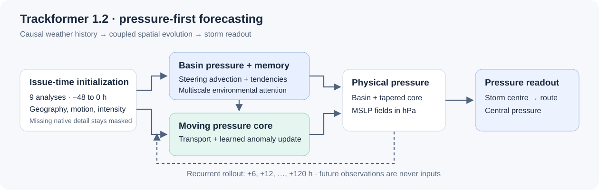

# TrackFormer 1.2 — pressure maps and five-day typhoon forecasts

An AI weather-research model designed to be trained and run on an ordinary home computer.

TrackFormer 1.2 predicts **Western Pacific pressure maps**, then obtains the typhoon's route and central pressure from the predicted pressure field. It updates the surrounding weather and a moving storm core together, every six hours from **+6 to +120 hours**. Horizontal winds at three pressure levels are updated within the model, providing a basis for studying northeasterly and southwesterly flow; this report's scored results concern track and pressure, not demonstrated monsoon-wind skill.

[Get the model](https://github.com/yu314-coder/typhoon-predict/releases/tag/trackformer-1.2) · [Hugging Face](https://huggingface.co/euler314/typhoon-predict) · [中文研究說明（與報告對照）](docs/research_report_zh.md) · [Live forecast](https://trackformer-weatherlab.rudin-euler-8253.chatgpt.site/live) · [Technical paper](paper/trackformer.pdf)

This page follows the Chinese research report **「訓練AI模型探討西北太平洋氣壓系統影響臺灣附近颱風的預測評估」** and its approved figure/text updates. It describes the released **1.2** model; later rainfall research is not a capability of these weights. The existing technical paper and older evaluation records remain separate, versioned references.

## Forecasting the field, not just the route

The model connects large-scale weather with the typhoon's pressure core:

- **Pressure maps through five days.** Basin-wide conditions and the moving core evolve at every forecast step.
- **Coupled track and intensity.** The predicted pressure core determines the centre and central-pressure estimate.
- **Causal inputs.** Nine historical weather analyses end at the issue time; no future observations or official forecast routes are used as prediction inputs.
- **Inspectable outputs.** Physical pressure grids, route points, timestamps and provenance are available alongside the visual forecasts.

This is a **research release**, not an operational warning service. Follow official agencies for safety-critical decisions.

## See the forecast: Mangkhut (2018)

[](https://huggingface.co/euler314/typhoon-predict/resolve/87a6e366b42bb4cc0edc95d2c50c55fca21a2c93/docs/trackformer_1_2_mangkhut.mp4)

[Watch / download MP4](https://huggingface.co/euler314/typhoon-predict/resolve/87a6e366b42bb4cc0edc95d2c50c55fca21a2c93/docs/trackformer_1_2_mangkhut.mp4) · **11 September 2018, 00 UTC** · **50-member mean** · **20 seconds**

GitHub plays the lightweight animated GIF inline; click it for the full-quality MP4. Hugging Face provides a native video player. The GIF preserves all twenty forecast states, one second each, and loops without adding a frozen ending.

The animation shows twenty actual six-hour forecasts through +120 h. The Western Pacific overview and close-up use the same geographic mean of the model's basin and moving-core pressure fields. Blue denotes low pressure and red high pressure, with 2 hPa isobars and 4 hPa labels. Forecast and observed routes share the same coordinates and valid times—neither is shifted to make them overlap.

This selected example illustrates the model, not typical skill. Observations are verification only. The 50 members are distinct seeded perturbations of **past and issue-time inputs**, not separately trained networks. Member fields are registered geographically before averaging; the mean centre need not locate the minimum of the mean map. Display interpolation does not add resolution to the approximately 20 km core.

[Pressure arrays](evaluation/release_data/pressure_core/mangkhut/common-pressure.npz) · [Field verification](evaluation/release_data/pressure_core/mangkhut/verification.json) · [Playback verification](evaluation/release_data/mangkhut_playback_verification.json) · [More examples and diagnostics](docs/showcase_archive.md)

## Results in the research report

The completed comparison uses **1,473 daily starts / 270 storms**, with all twenty +6 to +120 h leads. The pressure comparison uses a **subset of those same 270 storms**, not a different 270-storm dataset.

**DeepMind checkpoint: `WeatherNextCyclones_Mini_<2024` · trained through 2023 · native 1° · one member · WeatherNext software v0.3.0.** This is the official **Mini, not the full-sized WeatherNext model**. All reference forecasts completed on an **NVIDIA GeForce RTX 3070 using CUDA**. [Model identity and protocol](docs/deepmind_daily_benchmark.md) · [Completion receipt](evaluation/deepmind_daily/verification.json).


The bars show exact **24, 48, 72, 96 and 120 h** leads, not averages over each day. Track uses 270 storms; pressure uses 39–40 storms per displayed lead, with the counts printed in the figure. The table below averages all available six-hour leads using the common scoring procedure.

| Development metric · lower is better | TrackFormer 1.2 · mean of 50 | DeepMind Mini <2024 · one member | Shared coverage |
| --- | ---: | ---: | --- |
| Mean track error, +6 to +120 h | **471.20 km** | 498.37 km | 1,473 starts / 270 storms |
| Day 5 track error, +120 h | **1031.63 km** | 1031.91 km | 1,473 starts / 270 storms |
| Six-hour track-direction error | **34.96°** | 39.76° | 1,473 starts / 270 storms |
| Central-pressure MAE · JMA | 12.84 hPa | **10.20 hPa** | 134 starts / 40 storms / 2,637 valid lead records |

**Pressure coverage:** Of the 270 storms used for track, 40 meet the frozen common pressure-scoring conditions, giving 134 starts and **2,637 shared valid forecast-time records**. Each model is compared separately with the Japan Meteorological Agency records at the same valid times. This does **not** mean the remaining 230 storms have no pressure observations: the common subset inherits the original pipeline's issue-time intensity eligibility.

**Equal-storm scoring:** For each start, average the valid forecast-time errors; average starts within each storm; then average storms with equal weight. Missing labels and unsupported outputs are excluded, never zero-scored. Central-pressure MAE is not whole-map pressure error.

On this mixed historical/recent development cohort, 1.2 has lower mean position and heading errors; Mini has lower central-pressure MAE. **The recent-only track results favour Mini**: for strict issue years after 2024 (2025–2026), mean error is **258.7 km** for Mini versus **469.4 km** for 1.2, on 61 starts / 18 storms. Calendar 2024 is excluded from that subset. The combined cohort contains 230 storms from 1980–1999 and 40 recent storms; historical dates overlap Mini's training years. Different inputs and member counts make this a development comparison, **not a controlled architecture ablation, equal-compute test or certified untouched holdout**.

[Full saved scores and common support](evaluation/deepmind_daily/benchmark.json) · [Period breakdowns](evaluation/deepmind_daily/period_comparison.json) · [Independent publication audit](evaluation/deepmind_daily/publication_audit.json) · [Daily scoring protocol](docs/daily_storm_benchmark.md) · [Evaluation details and older comparisons](docs/trackformer_1_2_evaluation.md)

## Three report examples

The report compares predicted and reference pressure at **+48 h**, and routes and central pressure at **all twenty +6 to +120 h leads**. All maps retain the same valid time, coordinates and pressure scale; no forecast low is moved onto an observed route. Reference pressure is **NCEP analysis**, not a station-observation map. The report panels use a common **2.5° comparison grid**; smoother drawing does not create finer information.

| Example | Forecast issue (UTC) | Report figures |
| --- | --- | --- |
| Fung-wong / 鳳凰 (2025) | 2025-11-07 00:00 | [Pressure](docs/report_figures/fung_wong_pressure_comparison.png) · [Track / central pressure](docs/report_figures/fung_wong_track_pressure.png) · [Observed R34](docs/report_figures/fung_wong_observed_r34.png) |
| Mangkhut / 山竹 (2018) | 2018-09-11 00:00 | [Pressure](docs/report_figures/mangkhut_pressure_comparison.png) · [Track / central pressure](docs/report_figures/mangkhut_track_pressure.png) · [Observed R34](docs/report_figures/mangkhut_observed_r34.png) |
| Jebi / 燕子 (2018) | 2018-08-31 00:00 | [Pressure](docs/report_figures/jebi_pressure_comparison.png) · [Track / central pressure](docs/report_figures/jebi_track_pressure.png) · [Observed R34](docs/report_figures/jebi_observed_r34.png) |

All three use the same released checkpoint and 50-input-member policy. Fung-wong and Mangkhut use saved Metal forecasts; Jebi uses CPU forecasts from the same weights. Mangkhut and Jebi lie within the fitting years and are retrospective demonstrations, not unseen-case accuracy evidence. **The R34 panels are IBTrACS observed 34-knot quadrant-radius records, not model radius predictions or full wind maps.** Missing radii are left missing. There is **no native wind-radius forecast head** in 1.2.

[All report panels with captions](docs/research_report_zh.md#三個颱風展示) · [Figure hashes and sources](docs/report_figures/provenance.json) · [Earlier films and diagnostic archive](docs/showcase_archive.md)

## Training data and year cutoffs

**Released Trackformer 1.2 was fitted on 2000–2021 weather and typhoon data.** Validation used 2022–2023 for checkpoint selection; the original test partition used 2024–2025. **2026 live or historical forecasts are inference with frozen 1.2 weights, not training through 2026.**

| Data used by 1.2 | Source and variables | Years used for fitting |
| --- | --- | --- |
| Typhoon observations and labels | [NOAA IBTrACS](https://www.ncei.noaa.gov/products/international-best-track-archive)-derived storm positions, recent motion, available maximum wind and central pressure, with validity masks | 2000–2021 · Western Pacific-domain windows |
| Large-scale weather | [NOAA PSL NCEP/NCAR Reanalysis 1](https://psl.noaa.gov/data/gridded/data.ncep.reanalysis.html): sea-level pressure, 500 hPa height, and east/north winds at 850, 500 and 200 hPa; six-hour, 2.5° basin grid | 2000–2021 |
| Native regional pressure detail | [ARCO-ERA5](https://github.com/google-research/arco-era5) mean sea-level pressure at 0.25°, fixed issue-centred patches when available | 2000–2021 · 800 fitting windows |
| Static geography | ERA5 land fraction and surface geopotential converted to elevation, plus latitude/longitude | Static fields; not extra typhoon training years |

| Original whole-storm partition | Weather / typhoon years | Eligible six-hour windows | Native-pressure windows |
| --- | --- | ---: | ---: |
| Fitting · gradient updates and weather normalization | 2000–2021 | 13,949 | 800 |
| Validation · checkpoint selection, no gradient updates | 2022–2023 | 1,041 | 100 |
| Original test · evaluation only | 2024–2025 | 1,195 | 100 |

Each input contains nine analyses from −48 to 0 h. Later fields and best-track values are **training targets or evaluation labels**, never positive-lead prediction inputs. Entire storms stay in one partition and windows crossing a year-partition boundary are excluded. Weather normalization is fitted only on 2000–2021.

The eastward/northward wind pairs **u/v carry both direction and speed** at 850, 500 and 200 hPa. The 48-hour history is the fixed format used by this release; no matched 24/48/72-hour experiment established that two days is optimal.

The checksum-pinned source caches extend further: the derived typhoon archive reaches **13 July 2026**, and the NCEP basin archive reaches **17 March 2026, 18 UTC**. Those endpoints describe archive availability, **not the fitting cutoff**. Later live weather uses separately documented experimental GFS transfer; it does not update the released weights. This release has no satellite cloud-image or humidity input channel. Previously inspected test/showcase storms remain development evidence, not a newly untouched holdout.

[Training-source details and exact date ranges](docs/trackformer_1_2_training_data.md) · [Recomputed split counts and verified dataset hashes](evaluation/training_data/trackformer_1_2_provenance.json)

## How Trackformer 1.2 works



1. **Initialize from the past.** Nine six-hour analyses provide MSLP, 500 hPa height and winds at 850/500/200 hPa, ending at issue time. Static geography, the current observed centre, recent motion, current intensity and validity masks accompany the history. Native regional pressure detail is used when available; missing detail stays flagged. Current observations initialize the core, not future labels.
2. **Update the surrounding weather.** The model estimates changes in pressure and horizontal winds and carries information forward to the next six-hour step.
3. **Move and evolve the core.** A storm-centred pressure anomaly is transported relative to the environment and updated by learned tendencies. Basin pressure plus the tapered core anomaly forms the spatial forecast.
4. **Read out the storm.** A local low-pressure association identifies the centre within 300 km, and central pressure is sampled there. An auxiliary head provides a maximum-wind scalar, not a resolved surface-wind map.
5. **Roll forward.** Twenty autoregressive transitions produce +6, +12, …, +120 h forecasts. Training uses field, core, track, central-pressure, auxiliary-wind and masked change/displacement losses; future truth is a target, never an inference input.

| Released architecture | Configuration |
| --- | --- |
| Trainable parameters | 21,452,595 |
| Basin history | 9 × 8 × 25 × 33; −48 to 0 h |
| Moving core | 65 × 65; approximately 20 km spacing |
| Forecast steps | 20 × 6 hours |

Training increases the prediction horizon from one to two, three and five days, checking the full five-day forecast each epoch. The report uses the selected **epoch-4** checkpoint. [Model source and input contract](models/trackformer_1_2_field/README.md) · [Exact architecture and provenance](models/trackformer_1_2_field/manifest.json).

### What “50 forecasts averaged” means

The **same model weights** run 50 times with distinct seeded, small, smoothed zero-centred noise added only to normalized historical weather inputs. In the saved benchmark policy, basin noise has amplitude 0.025 with a 5-cell smoothing kernel; regional noise has amplitude 0.015 with a 9-cell kernel. These amplitudes are in normalized input units, not hPa or wind units. Issue-time storm position, motion and intensity, geography and validity masks stay fixed. Original observations and weights are not edited.

Routes and central pressures are averaged separately. Physical member pressure fields are placed on **common geographic coordinates before averaging**, rather than averaging unaligned moving-core array indices. This is a 50-member input-perturbation mean, **not 50 trained networks**. It is not proven optimal or automatically a calibrated uncertainty estimate; a full 270-storm clean-single-member versus 50-member accuracy comparison has not been established.

### Computers and software

- **Apple M4 Mac, 24 GB unified memory:** local model execution, data handling and plotting; PyTorch MPS uses the built-in GPU through Metal. Household-computer training and inference are the design goal, not a claim that every historical run used only this one machine.
- **NVIDIA GeForce RTX 3070 / CUDA:** verified execution of the completed DeepMind reference benchmark. This is hardware, not a software package.
- **Python / PyTorch**, NumPy, SciPy, xarray, netCDF4 and Matplotlib support modelling, data handling and figures. The Chinese report uses XeLaTeX / xeCJK.

## Open access and reuse

Code and project weights are **MIT licensed**, including modification, redistribution and commercial use. Source, training arrays and checkpoints are public without account approval or a download gate. [Openness inventory and remaining provenance gaps](OPENNESS.md) · [Contributing](CONTRIBUTING.md) · [Software citation](CITATION.cff). Upstream weather data retain their own terms and attribution.

## Complete training manual (PDF)

**[Download the single 106-page training and reproducibility PDF](docs/TrackFormer_1.2_Training_and_Reproducibility.pdf).** It contains data sources and processing, whole-storm partitions, normalization, tensor construction, architecture, initialization, all active losses, sampling, batches, truncated backpropagation, optimizer settings, curriculum, validation, checkpoint/resume behavior, recorded history, reproduction commands and limitations. A complete 40-file source/provenance appendix and an embedded exact-source ZIP are included; no separate Markdown pages are needed to read the method.

The checkpoint audit distinguishes facts from the archived recipe: the selected epoch-4 optimizer records **4,384 updates**, compatible with effective batch **16** under the published four-epoch sampler; the archived notebook recipe uses batch **10** and would produce 7,016 updates. Original argv/microbatch/worker settings were not recorded. The PDF explains that discrepancy, the epoch-2 minimum validation loss versus selected epoch 4, and the remaining raw-provenance/runtime gaps.

[Training source and asset index](training/trackformer_1_2/) · [Public exact corpus and optimizer checkpoints](https://huggingface.co/euler314/typhoon-predict/tree/main/training/trackformer_1_2). Project code/weights remain MIT; weather data retain upstream terms. This documentation publication does not rerun or modify any trainer.

## Get started

[Download weights and the complete pressure-map exporter](https://github.com/yu314-coder/typhoon-predict/releases/download/trackformer-1.2/trackformer_1_2_field_pressure_export_v2.tar.gz), or use this repository with the [Hugging Face weights](https://huggingface.co/euler314/typhoon-predict/resolve/main/models/trackformer_1_2_field/weights.pt). Put `weights.pt` in `models/trackformer_1_2_field/`. The inference weights and learned model equations are unchanged; the package includes the moving-core output and map renderer.

Prepare a normalized causal issue packet following the [input schema](models/trackformer_1_2_field/README.md), then run with PyTorch and NumPy:

```bash
python models/trackformer_1_2_field/predict.py causal_issue_packet.npz forecast.npz --device mps
```

Use `--device cuda` on a compatible NVIDIA setup or `--device cpu` for CPU inference. The packet is user-prepared, not a bundled live downloader. This command produces **one clean forecast**, not the benchmark's 50-member mean. Outputs include track coordinates, central pressure and basin, fixed regional and **moving-core MSLP grids in physical hPa through +120 h**, with geographic coordinates, coverage masks and exact valid times. The 20-km core is learned reconstruction, not native high-resolution observations.

For an immediate whole-WP and detailed-core PNG, add `--pressure-map pressure_120h.png --map-lead 120` to the command (Matplotlib required). To render another saved lead without rerunning the model:

```bash
python models/trackformer_1_2_field/plot_pressure.py forecast.npz pressure_24h.png --lead 24 --interval 2
```

Blue denotes low pressure and red high pressure. The renderer uses the actual saved moving field, coordinates and masks; it never draws a replacement vortex around a scalar pressure or observed track. See the [pressure-output schema](models/trackformer_1_2_field/README.md#render-a-pressure-map-directly).

The inference weight SHA-256 is `db49f36e85a3766defc4c172746897a1f783705d1ce8e6f9dfb8e87ae1d902cb`.

## Explore and use the data

The [History viewer](https://trackformer-weatherlab.rudin-euler-8253.chatgpt.site/history) combines playback, observed tracks, available model forecasts and pressure maps. The [public read-only API](https://trackformer-weatherlab.rudin-euler-8253.chatgpt.site/history-api) exposes issues, routes, fields, observations and provenance for other applications.

[Resource index](https://trackformer-weatherlab.rudin-euler-8253.chatgpt.site/api/history/v1/resources) · [Data catalogue](https://trackformer-weatherlab.rudin-euler-8253.chatgpt.site/api/data/v1/catalog) · [Benchmark JSON](https://trackformer-weatherlab.rudin-euler-8253.chatgpt.site/api/benchmarks/released)

The archive covers a pinned Western Pacific plan: six-hour starts from 1996 onward, the requested Wayne (1986) exception and older first issues since 1970—not all global storms or every older tick. Historical issues are **one member**; live50 and the showcased 50-member forecasts are separate. Core-field and learned-wind availability vary by issue; missing data remain unavailable. Consult [core status](https://trackformer-weatherlab.rudin-euler-8253.chatgpt.site/api/history/core-status) and [wind status](https://trackformer-weatherlab.rudin-euler-8253.chatgpt.site/api/history/wind-status) for current coverage.

## Limits and further reading

The auxiliary wind's averaging period and surface-wind skill are not validated. Optional pressure-derived wind/radius estimates are experimental diagnostics, not agency-equivalent forecasts. Pressure-map interpolation is not evidence of finer effective resolution. Retrospective analyses and experimental GFS live transfer must not be presented as operational validation.

See [wind-estimation assumptions](models/trackformer_1_2_field/WIND_ESTIMATION.md), [full intensity evaluation](docs/intensity_benchmark.md), [evaluation limits](docs/trackformer_1_2_evaluation.md), and the [example archive](docs/showcase_archive.md). Source, normalization and checkpoint identities are recorded in the [manifest](models/trackformer_1_2_field/manifest.json). Older release comparisons remain in the linked technical records, not the report's two-model headline table.

## Ongoing work: Taiwan rainfall

Ongoing research combines moisture, wind direction, weather outside Taiwan and terrain to study ordinary and heavy rainfall over Taiwan, with a separate observation-based evaluation. **Released 1.2 has no rainfall forecast head or humidity input.** These are research directions, not demonstrated rainfall improvements from the pressure model.

Model code is in [`models/`](models/), methods in [`paper/`](paper/), protocols in [`docs/`](docs/), results in [`evaluation/`](evaluation/) and reproducible utilities in [`release_tools/`](release_tools/).
