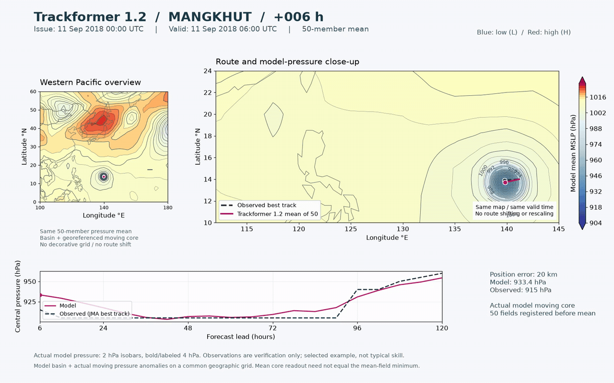

# TrackFormer 1.2 — pressure maps and typhoon forecasts

An open-source weather-research model designed to run on an ordinary home computer. It evolves Western Pacific pressure and winds every six hours, then reads the typhoon track and central pressure from the same moving pressure core through +120 h.

**[Complete training manual · PDF](docs/TrackFormer_1.2_Training_and_Reproducibility.pdf)** · [Model input/output guide](models/trackformer_1_2_field/README.md) · [Reference and protocols](docs/REFERENCE.md) · [Live / History](https://trackformer-weatherlab.rudin-euler-8253.chatgpt.site/live)

## See the forecast: Mangkhut (2018)

[](https://huggingface.co/euler314/typhoon-predict/resolve/87a6e366b42bb4cc0edc95d2c50c55fca21a2c93/docs/trackformer_1_2_mangkhut.mp4)

[Watch MP4](https://huggingface.co/euler314/typhoon-predict/resolve/87a6e366b42bb4cc0edc95d2c50c55fca21a2c93/docs/trackformer_1_2_mangkhut.mp4) · 11 September 2018, 00 UTC · 50-member input-perturbation mean. This selected retrospective example illustrates the model, not typical or unseen-case skill.

## Results in the research report

Completed **1,473 daily starts / 270 storms**, all twenty +6 to +120 h leads. Comparator: **DeepMind WeatherNext Cyclones Mini <2024**, native 1°, one member, software v0.3.0. TrackFormer uses the same weights with 50 perturbed historical-input runs. This is a development comparison, not equal-compute or certified untouched-holdout evaluation.

| Metric · lower is better | TrackFormer 1.2 | DeepMind Mini |
| --- | ---: | ---: |
| Mean track error, +6 to +120 h | 471.20 km | 498.37 km |
| Day 5 track error, +120 h | 1031.63 km | 1031.91 km |
| Six-hour track-direction error | 34.96° | 39.76° |
| Central-pressure MAE · JMA | 12.84 hPa | 10.20 hPa |

Pressure uses **134 starts / 40 storms / 2,637 common valid records**, a subset of the same 270 storms. This does not imply the other storms lack observations. Errors are averaged within starts, then within storms, then equally across storms. For the strict 2025–2026 subset, **Mini is better on track: 258.7 km versus 469.4 km**, 61 starts / 18 storms. Historical overlap and unequal inputs/member counts limit interpretation. [Full results and period breakdowns](docs/REFERENCE.md#docs-deepmind-daily-benchmark-md) · [Machine-readable scores](evaluation/deepmind_daily/benchmark.json).

## Run a forecast

```bash
python -m pip install -r requirements.txt
python models/trackformer_1_2_field/predict.py causal_issue_packet.npz forecast.npz --device mps
```

Download [weights.pt](https://huggingface.co/euler314/typhoon-predict/resolve/main/models/trackformer_1_2_field/weights.pt) into `models/trackformer_1_2_field/`. Use `--device cuda` or `--device cpu` as appropriate. The caller prepares the causal issue packet using the [input/output guide](models/trackformer_1_2_field/README.md). One clean run is distinct from a 50-member mean. Add `--pressure-map pressure_120h.png --map-lead 120` for an exported pressure image.

Inference-weight SHA-256: `db49f36e85a3766defc4c172746897a1f783705d1ce8e6f9dfb8e87ae1d902cb`.

## Train and inspect

The **[single 106-page PDF](docs/TrackFormer_1.2_Training_and_Reproducibility.pdf)** contains the complete available data process, architecture, active losses, sampler, optimizer, curriculum, validation, checkpoint/resume behavior, records and reproduction commands, plus 40 original text-source/provenance files and an embedded exact-source ZIP.

The original training code remains in `training/trackformer_1_2/`. Exact arrays, masks, warm start and full selected optimizer checkpoint are [public on Hugging Face](https://huggingface.co/euler314/typhoon-predict/tree/main/training/trackformer_1_2); `download_assets.py` verifies hashes without tokens or Drive permissions. Fitting years are **2000–2021**, validation **2022–2023**, original test **2024–2025**: 13,949 / 1,041 / 1,195 windows, with 800 / 100 / 100 native-pressure subsets. Nine analyses span −48 to 0 h. Future fields and observations are targets only.

The selected report checkpoint is epoch 4; epoch 2 has the minimum saved validation loss. Its recorded 4,384 optimizer updates are compatible with effective batch 16 under the published four-epoch sampler, while the archived notebook recipe uses batch 10. The PDF distinguishes that inference from the missing original argv/runtime and raw IBTrACS snapshot ID. No bitwise full retraining is claimed.

## Repository guide

| Location | Contents |
| --- | --- |
| `models/trackformer_1_2_field/` | Inference architecture, loader and pressure-map tools |
| `training/trackformer_1_2/` | Original trainer, data utilities, configuration, asset hashes and tests |
| `evaluation/` | Saved scores, support, audits and provenance |
| `release_tools/` | Export, benchmark, plotting and publication utilities |
| `docs/` | Training PDF, one reference document, figures and one archived documentation snapshot |

## Reuse, contribution and limits

Project code and weights use [MIT](LICENSE), including commercial use, modification and redistribution. Downloads are public and ungated. Upstream weather data retain their own attribution/terms. [Licensing and openness](docs/REFERENCE.md#openness-md) · [Contribution guide](docs/REFERENCE.md#contributing-md) · [Citation](CITATION.cff).

This is a research release, not an operational warning service. The approximately 20 km core is learned reconstruction, not new native observations. Released 1.2 has no rainfall head or humidity input; auxiliary wind and pressure-derived radius diagnostics are not validated agency-equivalent surface-wind forecasts. Follow official warnings for safety-critical decisions.
