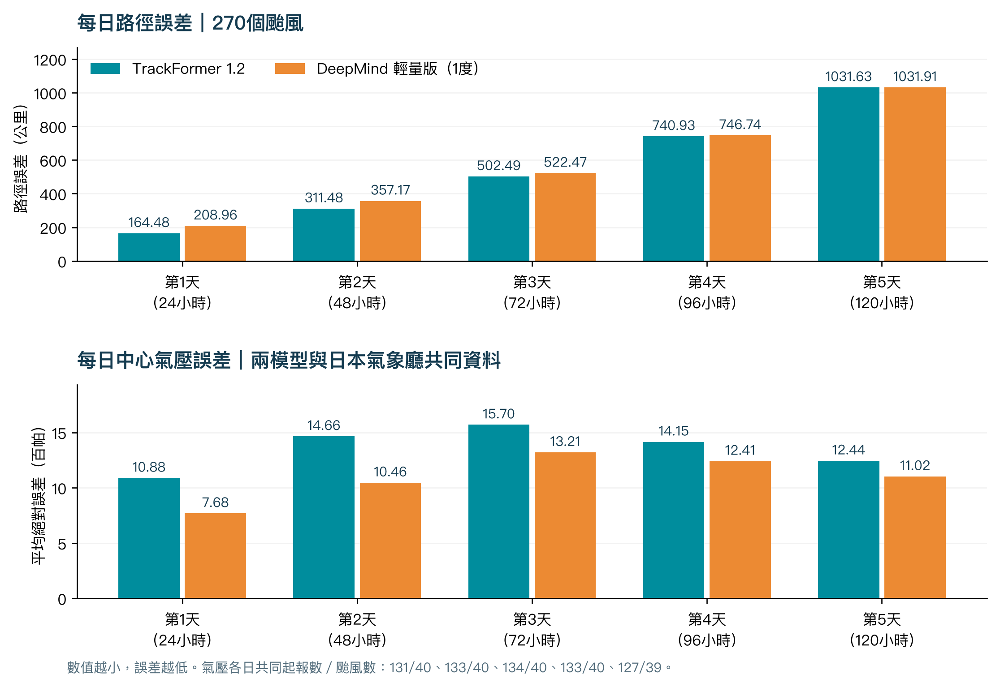
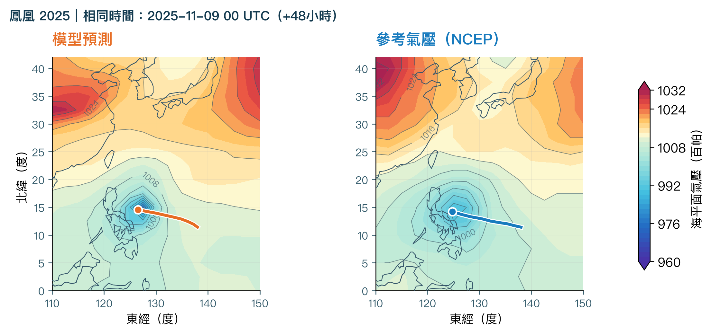
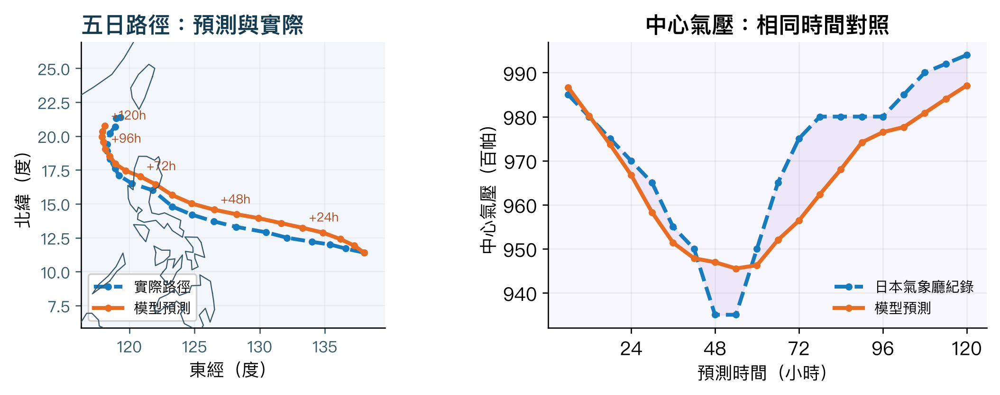
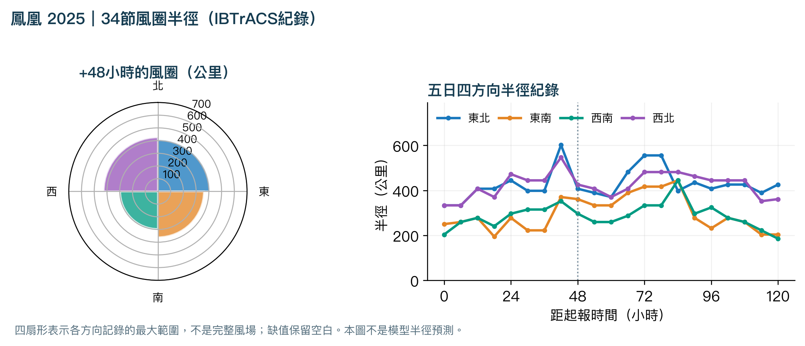
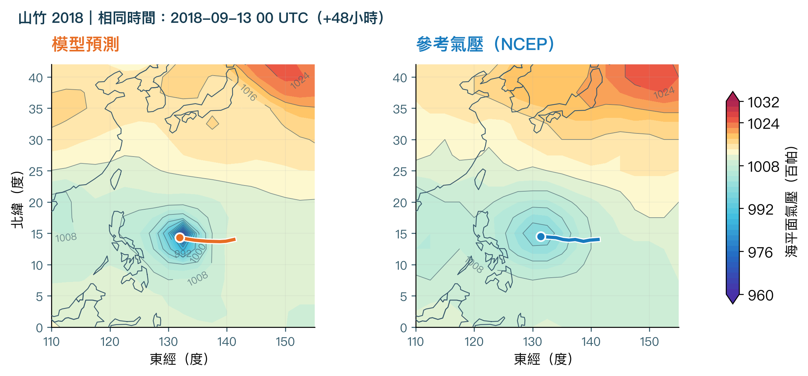
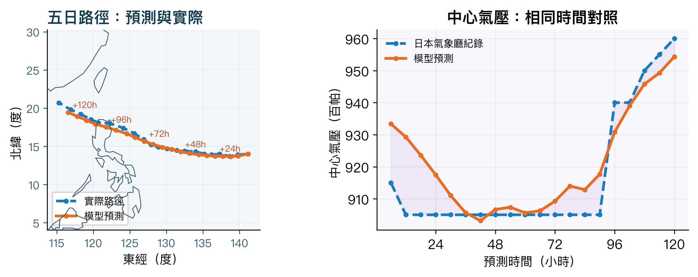
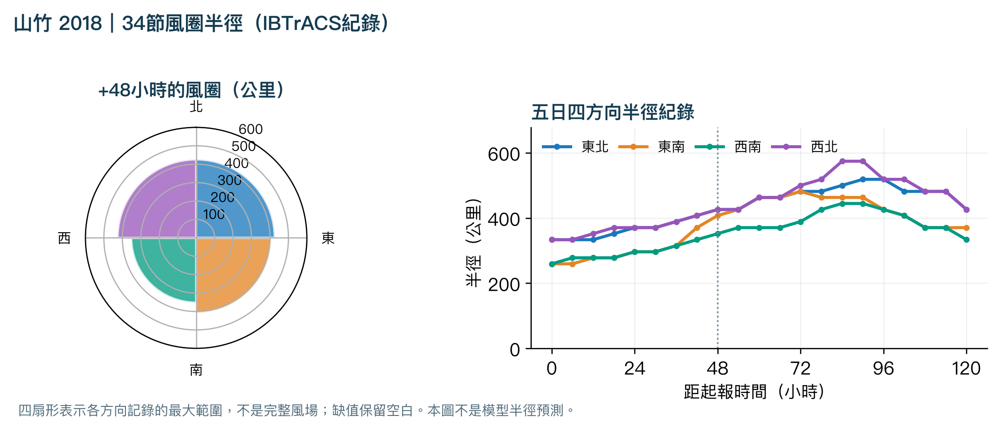
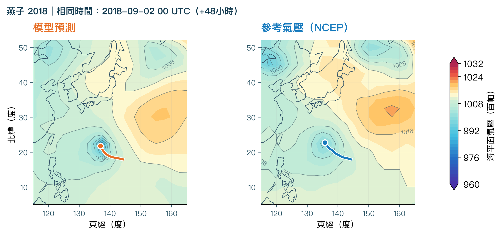
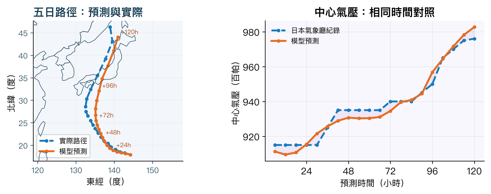
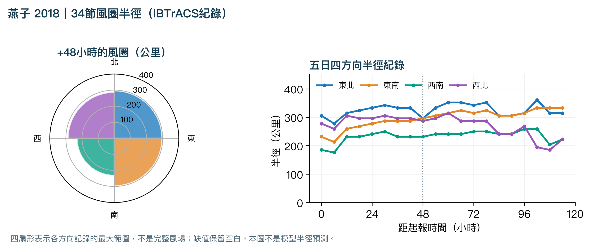

# TrackFormer 1.2 · technical reference

[Overview](../README.md) · [Model input/output guide](../models/trackformer_1_2_field/README.md) · [Complete training manual (PDF)](TrackFormer_1.2_Training_and_Reproducibility.pdf)

Use this page for scoring protocols, diagnostic assumptions, examples, data attribution and contribution guidance. The complete training explanation is in one PDF; code and machine-readable evidence retain their original paths.

## Start here

| Task | Read |
| --- | --- |
| Run and inspect a forecast | [Input/output guide](../models/trackformer_1_2_field/README.md) |
| Understand training and reproduce it | [106-page training PDF](TrackFormer_1.2_Training_and_Reproducibility.pdf) |
| Check the measured scorecard | [Main results](../README.md#results-in-the-research-report) and [benchmark JSON](../evaluation/deepmind_daily/benchmark.json) |
| Audit retained source documents | [Archived snapshot](archive/documentation-before-consolidation-20261030.zip) and [hash inventory](archive/documentation-manifest.json) |

**Reading the historical records.** The sections below preserve protocol and release explanations from the pre-consolidation documents. Operational counts are dated snapshots, not current job status. Different historical cohorts/revisions can have different scores; do not combine them into a new comparison. Current matched results are identified in the main scorecard and its saved JSON. Original document names are shown as provenance, not additional files you must open.

## Topics

- [Contribution workflow](#contributing-md)
- [License and public access](#openness-md)
- [Release history](#release-notes-trackformer-1-2-md)
- [Automatic forecasts and the history archive](#docs-automatic-forecasts-md)
- [Case selection and equal-storm scoring](#docs-daily-storm-benchmark-md)
- [DeepMind comparator and matched results](#docs-deepmind-daily-benchmark-md)
- [Pressure and intensity verification](#docs-intensity-benchmark-md)
- [Repository history and recovery](#docs-repository-layout-md)
- [中文研究說明](#docs-research-report-zh-md)
- [Forecast examples and diagnostic media](#docs-showcase-archive-md)
- [How to interpret the evaluations](#docs-trackformer-1-2-evaluation-md)
- [Evaluation artifact catalogue](#evaluation-readme-md)
- [Experimental wind and radius estimation](#models-trackformer-1-2-field-wind-estimation-md)
- [Plotting storm-structure diagnostics](#release-tools-storm-structure-diagnostics-md)
- [Dataset attribution and upstream terms](#training-trackformer-1-2-third-party-notices-md)


<a id="contributing-md"></a>

## Contribution workflow

*Source record: `CONTRIBUTING.md`.*

Anyone may inspect, fork, modify and retrain the public release under its MIT license. No contributor agreement or account approval is required to download or use the code and weights. Submitting a GitHub pull request requires your own GitHub account; local use does not.

### Reproduce first

1. Follow `training/trackformer_1_2/README.md` and pin the asset revision from `PUBLICATION.md`.
2. Verify dataset/checkpoint SHA-256 values before changing anything. Keep original weights and source artifacts unchanged and write experiments into new output directories.
3. Use `--preflight` for the archive/architecture check and `test_training_cpu.py` for the portable CPU loss/backward check. These reconstruct a writable local mmap, so use your own data copy rather than an active trainer's directory.
4. For pressure export changes, use the existing `release_tools/test_pressure_field_export.py` checks as applicable. There is no requirement to run the full multi-hour training job for a documentation correction.

### Share a change

Open an issue or pull request at https://github.com/yu314-coder/typhoon-predict . Explain the problem, changed behavior, exact model/data revision and relevant checks. Document new dependencies and retain third-party notices. Never commit credentials, private data or unrelated large caches. New project contributions should use the existing MIT license; third-party material must keep its own license and attribution.

For scientific claims, preserve issue-time causal inputs and whole-storm partitions; keep future observations as labels only. Compare on identical cases, grids, times and masks. Report misses and false alarms as well as mean errors, and identify previously reused development data. Do not infer forecast skill from a smoother map or training loss. Label changed architectures and weights as new candidates rather than silently replacing released 1.2.

The MIT license permits broad reuse; scientific review criteria apply to what this repository accepts or claims, not to your permission to fork or experiment independently.

<a id="openness-md"></a>

## License and public access

*Source record: `OPENNESS.md`.*

TrackFormer 1.2 is publicly accessible without account approval, a download gate, a paid API or Google Drive permissions. Project code and project model weights/checkpoints are distributed under the [MIT license](../LICENSE). You may use, study, modify, retrain, redistribute, sublicense and sell copies, including commercial use, subject to retaining the required copyright and permission notice. No research-only or non-commercial restriction is added by this project. The research/safety cautions describe capability limits; they do not replace or narrow the MIT license.

### What is public

| Component | Public location |
| --- | --- |
| Architecture, inference and physical pressure exporter | `models/trackformer_1_2_field/` on both repositories |
| Original training source, losses, sampler, curriculum and resume logic | `training/trackformer_1_2/source/v173/` |
| Portable launcher, configuration, tests and exact saved training history | `training/trackformer_1_2/` |
| Exact six derived dataset files, masks and original dataset manifest | Hugging Face: `training/trackformer_1_2/data/` |
| Original warm start and selected full training checkpoint with optimizer/RNG state | Hugging Face: `training/trackformer_1_2/checkpoints/` |
| Hashes and anonymous checksum-verifying asset downloader | `training/trackformer_1_2/assets.json` and `download_assets.py` |
| Benchmark protocols, measured results and figure provenance | `evaluation/`, `docs/` and `release_tools/` |

[GitHub source](https://github.com/yu314-coder/typhoon-predict) · [Hugging Face source and binary assets](https://huggingface.co/euler314/typhoon-predict) · [Training instructions](TrackFormer_1.2_Training_and_Reproducibility.pdf) · [Immutable publication links](TrackFormer_1.2_Training_and_Reproducibility.pdf) · [Contributing](#contributing-md)

Large arrays and optimizer checkpoints are hosted on Hugging Face and linked from GitHub, rather than duplicated in ordinary Git history. Downloads are standard public HTTPS; the asset downloader uses Python's standard library, verifies exact hashes and requires no token. Training/inference still require the documented open-source runtime dependencies. There is no hosted-service dependency in the published training launcher.

### Upstream data terms

NOAA/IBTrACS and Copernicus/ERA5 data retain their own provenance, attribution and applicable upstream terms. The project's MIT license cannot remove third-party conditions. See [the source notices](TrackFormer_1.2_Training_and_Reproducibility.pdf) and [data provenance](TrackFormer_1.2_Training_and_Reproducibility.pdf). The root `license: mit` metadata describes project software and model artifacts, not a blanket relicensing of all weather data.

### What is not claimed

The frozen derived arrays and their exact hashes are public, but the original raw IBTrACS snapshot/download ID was not recorded. A complete original runtime lockfile, original process argv and earlier warm-start training history have not been recovered. The archived recipe and warm-start checkpoint make the released v173 path runnable; bitwise full retraining across devices has not been demonstrated. The report selects epoch 4, while the saved aggregate validation-loss minimum is epoch 2. Previously inspected tests and examples are development evidence, not an untouched holdout.

Public availability is not a claim that every earlier 1.2 experiment or later rainfall experiment is this released model. No unavailable artifact, qualification result or score is invented to claim complete reproducibility. These remaining gaps stay visible so others can audit and improve the release.

<a id="release-notes-trackformer-1-2-md"></a>

## Release history

*Source record: `RELEASE_NOTES_TRACKFORMER_1_2.md`.*

**Documentation clarification (18 October 2026):** the current [English model page](../README.md) and [Chinese research explanation](#docs-research-report-zh-md) follow the research report's released-1.2 scope, household-computer goal, day-1–5 chart and three typhoon examples. Route uses 270 storms / 1,473 starts; the JMA pressure comparison uses 40 of those storms / 134 starts / 2,637 common valid records. The report's R34 panels are observations, not model radius forecasts, and Taiwan rainfall remains separate ongoing research. This updates documentation and existing figure copies only; weights, neural source and benchmark arrays are unchanged. Earlier release history below is retained as an archive.

**[Download weights + complete inference code](https://github.com/yu314-coder/typhoon-predict/releases/download/trackformer-1.2/trackformer_1_2_field_pressure_export_v2.tar.gz)** · **[Hugging Face](https://huggingface.co/euler314/typhoon-predict)** · **[Technical paper](https://github.com/yu314-coder/typhoon-predict/blob/main/paper/trackformer.pdf)**

Trackformer 1.2 forecasts Western Pacific storm tracks, central pressure and evolving sea-level-pressure fields through +120 hours. A multiscale environmental-attention network conditions the moving pressure core; track and central pressure are read from that evolving field.

### Direct detailed pressure-map output

The current package exports all twenty six-hour leads with:

- Whole-WP basin pressure, the original fixed regional composite, and the actual **65×65 moving-core pressure field in physical hPa**.
- Basin, regional and per-lead core latitude/longitude grids, coverage masks, issue time and exact valid times.
- Original track/central-pressure outputs and an explicit **one-member** count.
- Frozen weight/checkpoint identity and an optional PNG renderer: blue low pressure, red high pressure, labelled isobars.

```bash
python models/trackformer_1_2_field/predict.py causal_issue_packet.npz forecast.npz --device cpu --pressure-map pressure_120h.png --map-lead 120
python models/trackformer_1_2_field/plot_pressure.py forecast.npz pressure_24h.png --lead 24 --interval 2
```

NumPy and PyTorch are required for inference; Matplotlib is optional for images. Use `--device mps` or `--device cuda` on a compatible system. Prepare the nine-analysis causal input packet using the [published schema](https://github.com/yu314-coder/typhoon-predict/blob/main/models/trackformer_1_2_field/README.md); this package does not fetch live weather automatically.

The core's 20-km spacing is a learned computational reconstruction, not new native observations. Invalid coverage remains masked. Fields are not shifted onto a route, and central pressure is not inserted as a display vortex. Ensemble members require geographic registration before physical-field averaging; this command is not the separate 50-member benchmark policy.

**The learned modules, inference weights and forecast equations are unchanged.** The added export captures fields already produced by the released model. The original September 29 package remains available separately; use the pressure-export-v2 archive for the complete default output.

Inference weight SHA-256: `db49f36e85a3766defc4c172746897a1f783705d1ce8e6f9dfb8e87ae1d902cb`.

### Matched development results

| Measure | 1.1 | 1.2 mean of 50 | DeepMind Mini, one member | Matched coverage |
| --- | ---: | ---: | ---: | --- |
| Mean track error | 798.4 km | 471.2 km | 498.4 km | 1,473 daily starts / 270 storms |
| Direction error | 51.58° | 34.96° | 39.76° | Same daily starts |
| Central-pressure MAE against JMA | 13.53 hPa | 12.84 hPa | 10.20 hPa | 134 common starts / 40 storms |

Storms receive equal weight after valid leads and daily starts are averaged. The mean pressure reduction is small and its paired whole-storm uncertainty includes no improvement. These repeatedly inspected results are development evidence, not a certified untouched holdout. [Verified common-support metrics](https://github.com/yu314-coder/typhoon-predict/blob/main/evaluation/released_daily/released_daily_benchmark.json).

**The DeepMind comparison is complete and verified:** the official **WeatherNext Cyclones Mini `<2024`** checkpoint (1° resolution, trained through 2023), using **WeatherNext software v0.3.0**, completed all 1,473 daily starts / 270 storms on an RTX 3070 using CUDA. Mini's recent-only mean track error is **288.5 km**, better than 1.2's **477.2 km**. Historical fitting-year overlap, different weather inputs and unequal member counts prevent a general superiority claim. [Completed results and model identity](#docs-deepmind-daily-benchmark-md) · [CUDA completion receipt](https://github.com/yu314-coder/typhoon-predict/blob/main/evaluation/deepmind_daily/verification.json) · [Independent publication audit](https://github.com/yu314-coder/typhoon-predict/blob/main/evaluation/deepmind_daily/publication_audit.json).

The [model announcement](https://github.com/yu314-coder/typhoon-predict) includes the selected Mangkhut pressure-map animation and architecture. Selected examples are not representative skill. Auxiliary wind and pressure-derived radius diagnostics remain unvalidated; there is no native wind-radius forecast head in 1.2.

This is a research model, not an operational warning service or a safety-critical forecast. Trackformer 1.1 remains a separate release. No historical archive, media, benchmark predictions or training run is modified by this exporter update.

<a id="docs-automatic-forecasts-md"></a>

## Automatic forecasts and the history archive

*Source record: `docs/automatic_forecasts.md`.*

The existing repository runs the released Python checkpoint on **GitHub-hosted
CPU runners**, not on a visitor's browser or the owner's Mac. Every hour at
minute 17 (UTC and Asia/Taipei), the workflow checks all current in-domain
JMA storms. Lightweight backup checks at minutes 32, 47 and 57 start the same
writer only when the last published live check is at least one hour old.
The gate skips active or queued archive writers; the shared non-cancelling
publication lock remains on the inference job. Scheduled runs use
`historical_limit=0`; historical batches remain explicit or existing continuations.
GitHub may delay or drop schedules; this is not an exact wall-clock guarantee.
Public-repository schedules can be disabled after 60 days of inactivity.

The existing `automatic-forecasts.yml` schedule is the only live inference
scheduler; no second Sites or Mac automation is required. A new, validated JMA
analysis produces a new +120-hour issue and a separate **50-member live ensemble**
with genuine common-grid pressure means. Already completed issue IDs are skipped.
An hourly check does not imply that JMA or the six-hour GFS analysis grid supplies
new input every hour; unavailable sources remain explicit. The Live and History
views follow the latest completed
issue unless the viewer deliberately selects an archive. Updates continue with
the browser and Mac closed. The Live page polls every minute while visible and
again on focus or reconnect; History retains its five-minute poll. `status.json` exposes the last check, requested
3600-second interval, ensemble member count, source errors and cloud run URL.

Historical backfill now continues in **back-to-back serialized batches**: after
successfully publishing a productive batch, the workflow immediately dispatches
the next batch if uncomputed issues are ready. The same concurrency group permits
only one runner at a time. There can still be GitHub queue and environment setup
gaps; this is not a permanently running server. The hourly schedule remains
for live updates and delayed source retries. Continuation stops when all work is
complete, only cooling-down failures remain, a batch makes no successful progress,
or inference/publishing fails. A targeted single-issue retry does not start a chain.
No model, input boundary, membership, or forecast values are changed by this policy.

Historical outputs are **one deterministic member**, never labelled as the
separate 50-member live means. Recovery shares the same publication lock and
checks for overdue live input at an hourly threshold before starting a batch.
The historical target starts in **1970**. Recent playback takes priority:
**4,015 independent six-hour issues from all 135 eligible Western Pacific storms
in 2022–2026** in the current observed snapshot. Each tick initializes a new
+120-hour run, with that issue's centre, intensity, motion and nine causal analyses.
Fung-wong's 39 consecutive ticks are first for playback verification. These
are not shifted copies of an earlier route and are not selected by forecast error.
The completed first phase is preserved. The next phase adds **26,575 six-hour
issues for 1996–2021**; 2022 is already covered and is not rerun. The combined
queue now contains **32,143 issues**, including **30,590 six-hour ticks** and
1,553 preserved older first issues. All 5,568 original issue definitions and
completed forecasts remain unchanged. Older backfill retains the first
supported issue of each uncovered storm.
Out-of-domain global storms are not
silently extrapolated. A storm record is not a promise that usable weather exists.

Nine consecutive six-hour weather analyses end no later than issue time. Live
GFS is f000 only, with its final analysis at most twelve hours before the JMA
issue. Live sustained wind is read from JMA's analysis in knots when available;
missing wind remains missing. Motion remains explicitly missing; native detail
is masked. Initialization uses the analysis valid time, not bulletin publication
time, and rejects future or stale analyses. JMA's future forecast points are
comparison data only, never model inputs.
The resulting GFS transfer is experimental. Historical NOAA NCEP reanalyses are
retrospective, not operationally available inputs; fitting-year overlaps are
labelled and these forecasts are not a fresh independent evaluation.

NOAA **ended NCEP/NCAR Reanalysis 1 at March 17, 2026**
([source notice](https://psl.noaa.gov/data/reanalysis/)). Later historical issues
now use nine exact six-hour **archived GFS f000 analyses** from NOAA's public
archive. This is explicitly labelled an experimental GFS-input transfer, not
the original R1 evaluation or a claim of operational availability at the issue.
The complete history window uses one provider; R1 and GFS are not mixed within
an initialization. No later-valid analysis, forecast step, nearest-date fill,
or future observation can replace a missing analysis. Each new archive forecast
records the nine source URLs, valid times and GRIB-subset SHA-256 hashes.
Only the eight required GRIB messages are fetched with checked byte ranges;
timestamps, levels, units and missing values are checked again after decoding.
New analyses are cached across cloud batches to avoid re-downloading overlapping
history windows.

The input-only archive is checksum-pinned in `release_tools/history_inputs.json`.
Weights and source modules must match the release hashes before inference.
Complete finite +6…+120-hour outputs are saved on the `forecast-data` branch.
Old issues are immutable; new outputs are added, not substituted into old dates.
The live job is deduplicated by storm and exact analysis time. Historical errors
are retried after 24 hours while other storms can continue. A versioned input
reader correction releases old failures for one immediate retry; a new failure
then backs off normally. A manual exact-ID retry also bypasses the cooldown,
without starting an automatic batch chain. Status separately reports unresolved
planned-issue errors; obsolete issue IDs from earlier queues are preserved under
`retired_source_errors`, not presented as unresolved current work. Publication
and chaining require the independent saved-output audit to pass.

Public files beneath that branch's `data/` directory:

- `catalog.json`: available storms, exact issues, member counts and worker status.
- `status.json`: completion counts, live-issue availability, errors and run URL.
- `coverage.json`: 1970 boundary, domain and input-queue classifications.
- `verification.json`: an independent saved-output audit of every completed
  planned issue: release/member identity, observed +0 alignment, causal history,
  21 route points, 20 finite physical pressure grids, exact leads and catalogue
  coverage. `complete` is true only when every pinned planned ID is present.
- `forecasts/{id}.json`: geographic route, central pressure, provenance.
- `fields/{id}.json.gz`: losslessly compressed genuine model basin-pressure
  arrays in hPa. Existing uncompressed files remain readable. The public API
  transparently returns ordinary JSON for either format.

The Weather Lab API merges these results with its existing verified archive.
The GitHub Pages website can use the same public History API. A cache miss or
source outage remains explicit; no future observation is substituted as forecast.

### Playback and scale

The History player defaults to Western Pacific and orders storms by formation
time (first observed record), newest first. Its issue-time slider advances in
six-hour ticks. Each tick requires an exact matching saved initialization; it
pauses on an uncomputed tick rather than showing a previous issue as a new one.
A separate preview-lead selector chooses the pressure field from that issue.
The original one-issue animation remains available.

The full 1970-onward snapshot contains approximately 65,146 eligible six-hour
ticks across 1,919 WP storm records. The requested 1996-onward subset is queued
at six-hour frequency; pre-1996 full-tick expansion is not launched. Runtime
and compressed output size should be measured on the cloud pilot before
estimating total storage and wall-clock completion. The queued combined plan
contains 32,143 issues (30,590 ticks and 1,553 older first issues).
Scheduled batches attempt up to 500 issues or 45 minutes, whichever comes first.
An unavailable archived analysis may delay an individual historical tick; the
source error is retained and retried after 24 hours, never filled with truth.

The read-only hosted integration run
[36554550793](https://github.com/yu314-coder/typhoon-predict/actions/runs/36554550793)
verified two consecutive Fung-wong initializations: six hours apart, distinct
causal input hashes, distinct routes and distinct pressure arrays, with 20
forecast leads each. The second forecast completed about 1.27 seconds after the
first; the two-run pipeline took 6.5 seconds excluding package setup. This tiny
warm-cache sample is a throughput lower bound, not an ETA. At that rate the
recent cohort needs about 1.4 compute-hours and the full archive about 23 hours,
before weather retrieval, initialization, failures, publishing and scheduler
gaps. The former six-hour pause between productive backfill batches is removed;
NOAA availability can still block completion regardless of compute throughput.

A measured basin-field sequence used 44,311 bytes with lossless gzip: about
170 MiB for 4,015 issues, or 2.7 GiB for 65,146, excluding routes, catalogues,
Git history and existing outputs. These are single-sample storage estimates,
not fixed quotas or guaranteed total sizes.

<a id="docs-daily-storm-benchmark-md"></a>

## Case selection and equal-storm scoring

*Source record: `docs/daily_storm_benchmark.md`.*

Status: **complete** at 2026-09-29T08:22:39Z. All **1,473 daily cases / 270 storms** finished; the SHA-256 of every saved forecast was verified. [Final equal-storm results and all 270 storm scores](../evaluation/daily_storm_final.json).

Mean track error is 798.4 km for 1.1 and 471.2 km for 1.2 (50-member mean); +120 h error is 1,646.4 versus 1,031.6 km. Direction error is 51.58° versus 34.96°, centred shape similarity 0.7544 versus 0.8837, and geographic path similarity 0.5345 versus 0.6560. The original track run reported 1.2-only central-pressure MAE of 12.62 hPa on 40 pressure-labelled storms and basin MSLP MAE of 2.72 hPa on 270 storms. It did not produce 1.1 intensity outputs.

The completed [native pressure follow-up](#docs-intensity-benchmark-md) now provides a matched 1.1 comparison on 134 daily starts / 40 storms from the same frozen plan. JMA MAE is 13.53 / 12.84 hPa for 1.1 / 1.2; USA MAE is 12.84 / 12.55 hPa. Each uses exact common agency-specific labels. The 1,339 remaining issue inputs are unavailable to the frozen 1.1 intensity pipeline, never zero-scored or filled with future observations. Paired whole-storm intervals include zero. These are not all-270-storm pressure scores.

On 1 October, `release_tools/build_release_benchmark.py` independently rechecked all forecast hashes, coordinate conversions and daily/storm route aggregates, reproduced the native pressure postprocessor and generated the [shared snapshot](../evaluation/released_daily/released_daily_benchmark.json) and [original Trackformer audit receipt](../evaluation/released_daily/released_daily_verification.json). No inference or weight changes were necessary.

The [completed WeatherNext Cyclones Mini comparison](#docs-deepmind-daily-benchmark-md) now covers exactly the same 1,473 starts / 270 storms. Mini's combined mean track error is 498.4 km, direction error 39.76°, and JMA pressure MAE 10.20 hPa on 134 shared intensity starts. Its recent-only mean track error is 288.5 km versus 477.2 km for 1.2. The [independent three-way publication audit](../evaluation/deepmind_daily/publication_audit.json) rechecks the CUDA archive, unchanged original Trackformer arrays and recomputed common-support scores; the older 1 October receipt remains the audit of the original two-model snapshot, not a hash receipt for the subsequently merged JSON. No older benchmark's DeepMind score has been transferred into this comparison.

### What counts as a case and a score

One case is one typhoon at one issue time on one UTC day. Choose the earliest eligible issue on that day, once per typhoon. Each forecast predicts all 20 six-hour leads, +6 through +120 h, from information at or before issue time.

For position error, daily score = mean of the 20 lead errors; storm score = mean of that storm's daily scores; benchmark score = mean of the 270 storm scores. A storm with ten available daily starts has exactly the same final weight as a storm with three. The per-lead comparison also averages daily values within storm before averaging storms.

Direction error, route-shape similarity, Fréchet distance and path similarity remain separate metrics. Their definitions match the [evaluation notes](#docs-trackformer-1-2-evaluation-md); direction uses only common non-stationary leads. Missing direction scores are reported, not replaced by zero. There is no invented combined weighted quality mark.

### Frozen cohort

- 270 distinct storms, 1,473 daily issue cases, selected from 523 locally eligible storms.
- All 40 eligible recent storms beginning in 2024 or later, plus 230 historical storms selected at evenly spaced positions in the chronological 1980–1999 storm list.
- The entire storm must lie outside the selected 1.2 checkpoint's 2000–2021 fitting and 2022–2023 validation years, with the history/target boundary also outside those years.
- Issue centre within 0–60°N / 100–180°E; exact six-hour weather history through issue; complete route labels through +120 h; matching pressure-atlas coverage for scoring.
- Use all eligible daily starts for each chosen storm. Never drop a case because its forecast looks poor.
- [Cohort manifest](../evaluation/release_data/daily_storm_cohort.json) freezes rows, dates, storm IDs, source hashes and checkpoint identity before inference. Forecast artifacts are new; some recent storms overlap earlier development comparisons.

Requiring complete five-day truth excludes short remaining lifetimes. This is a declared coverage limitation, not an all-storm operational sample. Historical cases are retrospective hindcasts from a model trained on later years; reanalysis and best-track issue states do not establish real-time data availability. This cohort has not been certified untouched across all earlier experiments.

### Models and input boundaries

Trackformer **1.2** uses the unchanged released checkpoint and 50 independently seeded, smooth input-perturbation members. Seeds are `2043 + source_row * 100 + member_id`, with member IDs 0–49. Normalized perturbation amplitudes remain 0.025 for basin history and 0.015 for regional history. These are not learned latent samples or 50 separate trained models. Member routes and central pressures are averaged; physical fields are averaged on fixed common geographic grids. Missing native regional inputs retain the model's missing-detail mask.

Trackformer **1.1** uses the released causal weighted route builder with issue, −12 h and −24 h analyses and historical motion. Its absolute route is converted into the same issue-centred local-km coordinate system as 1.2. The pipelines differ, so this is a released-system comparison, not an architecture-only ablation.

Future weather/track/pressure are used for eligibility coverage and scoring only, never inference. No retraining, coefficient tuning, new weather downloads or checkpoint substitution occurs in this run.

### Pressure and failures

For the original 1.2 run, central-pressure MAE uses valid labels and cosine-area-weighted basin MSLP MAE uses the native basin grid, daily then equally per storm. Keep pressure label coverage visible. The separate native-pressure follow-up uses a paired mask for both models at each agency's exact valid times; it does not substitute its smaller coverage into all-storm track results. Regional/core field scores need their own valid coverage and are not implied by basin-wide error. No same-cohort 1.1 basin-field score is claimed.

Completed daily forecasts are saved atomically with hashes. A nonfinite forecast or source mismatch stops the run visibly rather than silently deleting the case. Resume skips completed cases without rerunning them. Partial aggregate scores include only fully completed storms, identify their counts, and must not be presented as the final 270-storm result. Final uncertainty should resample whole storms, not overlapping daily issues independently.

<a id="docs-deepmind-daily-benchmark-md"></a>

## DeepMind comparator and matched results

*Source record: `docs/deepmind_daily_benchmark.md`.*

### Model and frozen plan

**Complete and verified:** all **1,473 daily forecasts / 270 Western Pacific storms** finished on an **NVIDIA GeForce RTX 3070 using JAX CUDA in Windows/WSL**. The final worker audit is dated **4 October 2026, 12:55 UTC**. Publication independently rechecked all returned case hashes, physical grids, unchanged Trackformer reference arrays and exact common-support scores. No new inference was performed during this review.

The reference is Google's official [WeatherNext Cyclones Mini](https://github.com/google-deepmind/weathernext#weathernext-cyclones-mini): **`WeatherNextCyclones_Mini_<2024`**, trained through 2023 at native **1° resolution**. The pinned [software package is v0.3.0](https://github.com/google-deepmind/weathernext/blob/89c4b2a77a1c57b328b909c575550fd2e5aadc9c/setup.py); the package version and checkpoint generation identify different things. This is not a custom imitation, full-sized WeatherNext 2/Cyclones, or a WeatherNext 3 checkpoint. Mini's scores do not stand in for those larger models.

- Cohort: **1,473 daily starts / 270 Western Pacific storms**, identical to the frozen Trackformer 1.1/1.2 route comparison.
- Forecast: twenty six-hour steps, **+6 to +120 h**, with the exact observed issue-time centre as the initialized-storm anchor.
- Inputs: exact ERA5 analyses at **issue−6 h and issue**, calendar forcings only after issue. No future weather, storm labels or official forecast tracks enter the worker.
- Weights SHA-256: `a1bb151457077248d70a458b1a7b19deacd2926fbcb46eee4ff2691444e3596e`.
- Cohort SHA-256: `965184f1e5ab3fcb52e304f39b38583a14f753870aa2295f2d01942a441dcfd6`.
- Official code commit: `89c4b2a77a1c57b328b909c575550fd2e5aadc9c`.
- CUDA protocol SHA-256: `91b31582f24ffdd4f2309eddb0cc68498a2c31cab7cbabaf06f43dfbff413606`.
- Runtime: JAX/JAXlib 0.4.38, Python 3.12.3, highest float32 matmul precision, TF32 disabled.

### Results

| Matched development metric | Trackformer 1.1 | Trackformer 1.2 · mean of 50 | Mini · one member | Coverage |
| --- | ---: | ---: | ---: | --- |
| Mean track error · km, lower is better | 798.41 | 471.20 | 498.37 | 1,473 days / 270 storms |
| +120 h track error · km, lower is better | 1,646.40 | 1,031.63 | 1,031.91 | 1,473 days / 270 storms |
| Direction error · degrees, lower is better | 51.58 | 34.96 | 39.76 | 1,473 days / 270 storms |
| Centred route-shape similarity · higher is better | 0.7544 | 0.8837 | 0.9010 | 1,473 days / 270 storms |
| JMA central-pressure MAE · hPa, lower is better | 13.53 | 12.84 | 10.20 | 134 days / 40 storms / 2,637 leads |
| JMA pressure-curve similarity · higher is better | 0.7074 | 0.7118 | 0.8088 | 134 days / 40 storms |
| USA central-pressure MAE · hPa, lower is better | 12.84 | 12.55 | 11.55 | 134 days / 40 storms / 2,325 leads |
| USA pressure-curve similarity · higher is better | 0.7237 | 0.6637 | 0.7445 | 131 days / 40 storms |

Pressure measures central-pressure intensity, not map-grid error. The lower USA curve count excludes flat/short curves; it is not zero-filled. All three models' pressure-curve case IDs were verified equal for each agency. DeepMind geographic path/Fréchet scores and whole-storm confidence intervals are not supplied by this export and remain unavailable.

#### Historical and recent groups

| Period | Daily starts / storms | Mean track error · 1.1 / 1.2 / Mini, km | Direction error · 1.1 / 1.2 / Mini, degrees |
| --- | --- | --- | --- |
| 1980–1999 | 1,336 / 230 | 780.50 / 470.17 / 534.86 | 51.36 / 35.01 / 41.26 |
| Storms beginning in 2024+ | 137 / 40 | 901.45 / 477.16 / 288.51 | 52.90 / 34.68 / 31.16 |

Mini has better recent-only track scores even though 1.2 has lower position/heading errors in the combined cohort. Mini also has lower JMA/USA pressure MAE and higher pressure-curve similarity. Historical fitting-year overlap, different weather inputs and different ensemble sizes prevent a general or equal-compute superiority claim. All pressure comparisons here belong to the recent group; no historical pressure score is inferred from missing native 1.1 inputs.

[Full results, period breakdowns and per-lead track errors](../evaluation/deepmind_daily/benchmark.json) · [Shared snapshot and existing 1.1/1.2 uncertainty](../evaluation/released_daily/released_daily_benchmark.json) · [Completion receipt](../evaluation/deepmind_daily/verification.json) · [Independent review](../evaluation/deepmind_daily/publication_audit.json)

#### Strict forecast-date partition and separate charts

All three README charts—total, strict `<2024` and strict `>2024`—use **`WeatherNextCyclones_Mini_<2024`**, the same official checkpoint trained through 2023, software v0.3.0, native 1° and one CUDA member. A post-2024 forecast is not a post-2024-trained model. The following proportions refer to this evaluation cohort, not the model's training dataset.

| UTC issue year | Starts / share | Storms / share |
| --- | --- | --- |
| `<2024` (1980–1999 here) | 1,336 / 90.7% | 230 / 85.2% |
| Calendar 2024 | 76 / 5.2% | 22 / 8.1% |
| `>2024` (2025–2026 here) | 61 / 4.1% | 18 / 6.7% |

The original `recent_2024_onward` aggregate includes 2024 and is retained unchanged. The new **strict `after_2024`** derivative excludes 2024: track position MAE is **963.02 / 469.40 / 258.67 km**, direction error **57.88 / 33.81 / 28.73°**, and JMA pressure MAE **12.59 / 11.12 / 9.55 hPa** for 1.1 / 1.2 / Mini. Track uses 61 starts / 18 storms; pressure uses 59 starts / 18 storms / 1,174 exact common leads. The total chart still uses the original scores. Its historical 230 storms contribute 85.2% of equal-storm track weight, not 90.7%.

The strict **`before_2024`** chart uses the 1,336 historical starts / 230 storms (1980–1999 here): position MAE **780.50 / 470.17 / 534.86 km** and direction error **51.36 / 35.01 / 41.26°** for 1.1 / 1.2 / Mini. All three shared JMA pressure scores are null, with zero eligible common starts: frozen historical 1.1 intensity inputs are unavailable. That panel says **Not scored** and contains no bars, not zero-height bars. Track coverage must never be reused as pressure coverage.

[UTC partitions, exact case IDs, all metrics and source hashes](../evaluation/deepmind_daily/period_comparison.json) · [Total chart](../evaluation/released_daily/model_1_2_benchmark.png) · [Pre-2024 chart](../evaluation/released_daily/model_1_2_before_2024_benchmark.png) · [Post-2024 chart](../evaluation/released_daily/model_1_2_after_2024_benchmark.png)

Reproduce these derivative summaries without inference or raw-weather downloads:

```bash
python release_tools/build_deepmind_period_comparison.py --archive /path/to/DeepMind_RTX3070_results_20261004_125651_467960.zip
python release_tools/plot_model_announcement.py
```

The helper checks the exact archive hash against the existing publication audit and every one of the 1,473 case-score JSON hashes against the frozen manifest. It rechecks identities, causal-time metadata, CUDA completion and common pressure masks, reproduces the original total and period scores, then recomputes only the UTC subsets using the unchanged equal-storm aggregation. It never rewrites the original worker export, changes a forecast array or claims a new raw-input audit. Chart sidecars identify their derivative source hash, checkpoint, period, exact values and missing-data policy.

### Like-for-like scoring

All three models use the frozen starts, exact future label times and original issue-relative kilometre projection. Routes are unshifted. Direction is recomputed on **common moving steps across truth and all three models**, not compared using different masks.

Pressure uses the original 134 eligible native-intensity starts / 40 storms, restricted to common valid leads across three predictions and the selected reference. JMA and USA remain separate. MAE and centred time-curve similarity are separate; missing, nonphysical or failed outputs are not zeros. Flat or shorter-than-six-point curves have unavailable shape similarity.

Average valid leads within an issue, days within a storm, then storms equally. Partial aggregates contain only fully completed storms and explicit coverage. Recent 2024+ and historical 1980–1999 groups are separate because the latter overlap WeatherNext fitting years. Different input pipelines and the one-member Mini versus 50-input-member 1.2 policy make this an output comparison, not an equal-compute architecture ablation or a certified unused test.

The official six-hour direct tracker uses a frozen initialized-storm continuity policy: no cyclogenesis, no dissipation pruning and no nearby-cyclone pruning. This is disclosed rather than called the operational default. Native 1° WP MSLP grids are saved in physical hPa; cyclone-head central pressure is not the basin-grid minimum.

### Execution and verification

The original [Mac CPU runner and scoring definitions](../release_tools/deepmind_daily_benchmark.py) provided the frozen plan. The completed run used the separately pinned, resumable RTX 3070 CUDA package; the old CPU launch instructions are not the execution record of these results. The [frozen CUDA protocol](../evaluation/deepmind_daily/protocol.json), [2,946-file case manifest](../evaluation/deepmind_daily/case-manifest.json) and [CPU/CUDA canary](../evaluation/deepmind_daily/canary.json) identify the completed run.

The strict same-runtime CPU/CUDA canary passed unchanged 0.01 hPa mean / 0.1 hPa maximum field tolerances. Its older cross-runtime Mac comparison failed the maximum-field gate and remains explicitly recorded as failed; that diagnostic is not numerical-equivalence certification. No CPU forecast was counted or relabelled as a CUDA case.

The publication review checks all 1,473 IDs, original reference hashes, exact issue−6 h / issue input-time metadata and saved input hashes, all twenty output times, finite native pressure grids, and recomputed three-model route/pressure metrics. **Raw ERA5 input states are not in the returned result-only ZIP**: this review preserves the original workers' causal-input receipts and hashes, rather than claiming to independently reopen those raw states.

To repeat the read-only archive review, use the existing frozen project reference forecasts and intensity labels, NumPy, and the returned result archive. It does not run a model or download weather:

```bash
python release_tools/import_deepmind_release_results.py \
  --archive /path/to/DeepMind_RTX3070_results_20261004_125651_467960.zip \
  --project /Volumes/D/typhoon_predict \
  --output /Volumes/D/typhoon_predict/remote_typhoon_predict_repo/evaluation/deepmind_daily
```

Completed scores are also exposed by the existing [public benchmark API](https://trackformer-weatherlab.rudin-euler-8253.chatgpt.site/api/benchmarks/released). Documentation publication does not replace immutable forecasts, change either model's weights, restart the benchmark, modify active training, or redeploy the website. The original two-model verification receipt remains unchanged; the new publication audit identifies the merged snapshot's exact hash.

The returned worker's `benchmark.json` is retained byte-for-byte for its audit hashes. Its `published_to_site: false` and `integration_note` describe the handoff before import, not the current benchmark status. The completed CUDA receipt, independent publication audit and shared public snapshot above are the current completion/publication evidence; those historical worker fields do not mean the comparison is unfinished.

<a id="docs-intensity-benchmark-md"></a>

## Pressure and intensity verification

*Source record: `docs/intensity_benchmark.md`.*

Completed GPU inference and verified aggregation on 1 October 2026 (Taipei).
The released weights, original forecasts and original calibration are unchanged.

### Same hierarchy as track

The plan is the frozen 270-storm / 1,473-daily-issue track cohort. One storm on
one UTC day is one case, at its earliest eligible issue. Forecast errors at
valid +6, +12, …, +120 h leads are averaged per daily issue, then across its
storm's daily issues, then across storms with equal weights. Long-lived storms
do not gain extra final weight. Per-lead errors use the same daily → storm
averaging. Both models use exactly the same native observation mask for each
wind/pressure comparison. Wind and each agency's pressure are separate metrics;
there is no arbitrary weighted combined rank.

Native 1.1 intensity needs valid issue-time current wind and pressure. Its
frozen input archive provides them for 134 daily issues / 40 storms, not the
other 1,339 daily starts. These missing starts are reported, never repaired
with future observations or relabeled as zero error. Thus the result shares
the **method and planned cohort** of track, but does not claim the same valid
intensity coverage. Missing future observations also remain unavailable.

### Model identity and inference

1.2 is the released checkpoint SHA-256
`f194a23d3f91ea76ad776dfad942fabd669eeae8b3fd665815463095367e9ee0`.
Every original pressure forecast file is rehashed. To recover previously
unsaved auxiliary wind, the MPS runner replays the identical 50 input members
with seeds `2043 + source_row * 100 + member_id`, nine exact causal analyses,
original detail masks and original issue inputs. Every replay has 50 distinct
input hashes, finite 50 × 20 wind and pressure outputs and verified means.
The maximum pressure difference from original forecasts is **0.0 hPa**.
No weights, preprocessing or coefficients are fitted here.

1.1 uses the original public intensity pipeline: frozen primary and structure
experts, validation-fit anchor/calibration coefficients, and the frozen
same-storm −12/−24 h temporal branch where its current-wind gate permits.
Expert count/activation is preserved in each case receipt; this is not a
50-member 1.1 ensemble. Issue states and causal weather only enter inference;
future labels are loaded separately for scoring. The two systems' input
pipelines differ: this is not an architecture-controlled ablation.

### Native observation definitions

- Central pressure: exact storm SID and valid UTC; native `USA_PRES` and
  `TOKYO_PRES` are scored separately, in hPa, on a common mask for each agency.
- Wind: `USA_WIND` nominal one-minute reference. The 1.2 scalar is an auxiliary
  output, not a certified ten-metre sustained surface-wind product. JMA
  `TOKYO_WIND` is ten-minute and is never converted or pooled in this score.
- Native 1.1 radius: `USA_RMW` and `USA_R34/R50/R64_NE/SE/SW/NW`, nautical miles
  multiplied by 1.852 to kilometres. They are radii, not diameters. RMW must be
  positive. A reported zero wind-radius extent remains valid; blanks remain
  unavailable. JMA R30 longest/shortest, eye size and ROCI are not substitutes.
- Native 1.2 radius: **not available**, because it has no radius head. The
  experimental pressure-scaled candidate is separate; its strict definition
  guard prevents scoring it as calibrated official surface-wind radii.

Radius errors are averaged within the daily issue over valid leads for each
component, then equally across available quadrant components, then across
days within storm and equally across storms. Coverage differs by threshold;
all counts are printed. Observational RMW has reporting/provisional limitations.

### Curve comparison, analogous to route direction and shape

The released Site defaults to **central-pressure MAE**, with slight descriptive mean improvements (JMA 13.53 / 12.84 hPa; USA 12.84 / 12.55 hPa, for 1.1 / 1.2) and paired uncertainty including zero. Its secondary **similarity** view is the exact complement of the shape-error metric below: `(1 + centred cosine) / 2 = 1 − shape_error`. This is a presentation transform, not a new fit or score. JMA similarity is 0.7074 / 0.7118 on 40 storms and 134 starts; USA similarity is 0.7237 / 0.6637 on 40 storms and 131 non-flat starts. Unshifted physical hPa timelines remain visible separately. The public snapshot includes every input-eligible pressure timeline.

Magnitude MAE is retained alongside time-curve diagnostics, without optimizing
time lag, warping time, shifting observations or adjusting forecasts to truth.
These are separate, versioned post-hoc descriptive metrics, not a preregistered
untouched-holdout hypothesis test.

1. Curve-shape error = `(1 - centred cosine similarity) / 2`, lower is better.
   Subtract each curve's common-lead mean, normalize its scalar magnitude and
   keep original time order and sign. At least six common valid points and
   non-flat truth and both forecasts are required. A flat/unavailable curve
   does not receive a perfect score. This measure ignores level and amplitude,
   so it does not replace MAE or demonstrate matching absolute intensity.
2. Trend-direction mismatch = fraction of adjacent six-hour changes whose
   signs differ (increasing / flat / decreasing). Deadband is exactly zero;
   flat-versus-changing is a mismatch. Missing leads break adjacency, never
   form twelve-hour changes disguised as six-hour steps.
3. Six-hour tendency MAE = mean absolute error of those adjacent changes in
   kt/6 h, hPa/6 h or km/6 h. It remains separate from shape error.

All daily curve scores use the same valid model/reference masks before the
storm aggregation. Uncertainty uses 2,000 whole-storm bootstrap replicates
with seed 4712, not overlapping issue resampling. Paired 1.2-minus-1.1
differences and their intervals are included in the full JSON report.

### Results and honest boundaries

USA pressure MAE: 1.1 **12.84** vs 1.2 **12.55 hPa**. JMA pressure MAE:
**13.53** vs **12.84 hPa**. Auxiliary wind diagnostic MAE: **16.98** vs
**25.03 kt**. Wind curve-shape error: **0.271** vs **0.385**. Thus wind is
worse for 1.2 despite the slight mean-pressure improvement. At +120 h USA
pressure is worse for 1.2, whereas JMA pressure is better; no all-lead/agency
win is claimed. Radius 1.1 errors are reported, but native 1.2 is N/A.

The old 1980–1999 cohort overlaps original 1.1 fitting, and 1.2 hindcasts are
retrospective predictions by a model trained on later years. Some recent
storms have been inspected in development. Complete five-day route labels
were required by the inherited cohort. This is not untouched generalization,
an operational comparison or proof of no overfitting. Scientific safety and
wind/radius definition limitations apply to all illustrated examples.

### Files and reproduction

[Verified aggregate and per-storm metrics](../evaluation/intensity/intensity_final.json)
· [Chart verification receipt](../evaluation/intensity/verification.json)
· [GPU runner](../release_tools/benchmark_intensity_v12_v11.py)
· [Independent verifier and plotter](../release_tools/plot_intensity_benchmark.py).

```sh
MPLCONFIGDIR=/Volumes/D/typhoon_predict/.cache/matplotlib \
  /Volumes/D/typhoon_predict/.venv/bin/python -B \
  release_tools/benchmark_intensity_v12_v11.py \
  --project /Volumes/D/typhoon_predict \
  --output /Volumes/D/typhoon_predict/output/intensity-v12-v11-20261001 --chunk 10

MPLCONFIGDIR=/Volumes/D/typhoon_predict/.cache/matplotlib \
  /Volumes/D/typhoon_predict/.venv/bin/python -B \
  release_tools/plot_intensity_benchmark.py \
  --source /Volumes/D/typhoon_predict/output/intensity-v12-v11-20261001 \
  --project /Volumes/D/typhoon_predict \
  --output /Volumes/D/typhoon_predict/remote_typhoon_predict_repo/evaluation/intensity
```

The runner locks one process and resumes immutable completed cases. It never
silently restarts training. Large original forecasts/raw members remain on D;
public reports include exact source hashes and complete verified aggregates.

<a id="docs-repository-layout-md"></a>

## Repository history and recovery

*Source record: `docs/repository_layout.md`.*

The current source tree is focused on the selected pressure-field **Trackformer 1.2** release. The implementation remains at `models/trackformer_1_2_field/`; module filenames such as `v165_base.py` are required architecture dependencies, not unused legacy files. They and their source hashes have not been changed.

### Cleanup on 29 September 2026

Removed from the current branch:

- The withdrawn route/scalar `trackformer_1_2.py` candidate and its incompatible `examples/predict_trackformer_1_2.py` entry point.
- Root-level 1.1 inference/route/intensity/temporal modules and their old analysis utility, plus `colab_train_v17.ipynb`.
- The old 1.1 paper and superseded 1.2.26/matched100 comparison assets.

Moved current benchmark figures, metrics and plot data from `paper/` into `evaluation/`, updating documentation and reproduction paths. `paper/trackformer.tex` and `paper/trackformer.pdf` stay at their existing locations. Published HTML and MP4 URLs under `docs/` stay unchanged.

The 1.1-versus-1.2 comparison arrays, TIP diagnostic, current paper, weights, model source hashes and release tags are retained. No local research checkpoints, running benchmark, Hugging Face files or historical release assets were deleted by this source-tree cleanup.

### Recovery

The complete pre-cleanup repository remains in [commit 459a3d014aa4794652ceba3ecdffcde0beada2cd](https://github.com/yu314-coder/typhoon-predict/tree/459a3d014aa4794652ceba3ecdffcde0beada2cd). The [Trackformer 1.1 release](https://github.com/yu314-coder/typhoon-predict/releases/tag/trackformer-1.1) remains available. This cleanup does not rewrite Git history.

### Released 1.2 training

`training/trackformer_1_2/` contains the original training source, launch wrapper, requirements, historical preparation tools, configuration, hashes and public asset downloader. Large arrays and optimizer checkpoints live at the identical Hugging Face path and are referenced from GitHub.

<a id="docs-research-report-zh-md"></a>

## 中文研究說明

*Source record: `docs/research_report_zh.md`.*

**作品名稱：訓練AI模型探討西北太平洋氣壓系統影響臺灣附近颱風的預測評估**

本頁對照中文研究報告及本次核定的文字、圖表修改。只介紹發布的 **TrackFormer 1.2**；原有技術論文與歷史比較紀錄保留於各自的檔案，不取代本頁的報告範圍。

[GitHub 程式與研究紀錄](https://github.com/yu314-coder/typhoon-predict) · [Hugging Face 模型](https://huggingface.co/euler314/typhoon-predict) · [即時預測頁](https://trackformer-weatherlab.rudin-euler-8253.chatgpt.site/live) · [English overview](../README.md)

### 研究動機與目標

- 以一般家用電腦可訓練、可執行為目標，讓個人及學生能參與天氣預測研究。
- 建立預測西北太平洋氣壓圖的 AI 模型，再從同一預測氣壓取得颱風路徑與中心氣壓。
- 結合不同高度的水平風，提供研究東北風、西南風與颱風周圍氣流變化的基礎。本次成果評分以路徑與氣壓為主，並非已證明季風預測改善。

### 研究設備與器材

| 設備或工具 | 實際用途與範圍 |
| --- | --- |
| Apple M4 Mac、24 GB 統一記憶體 | 本機模型執行、資料處理與製圖；透過 PyTorch MPS 使用內建 GPU 與 Metal。家用電腦訓練與執行是研究目標，不代表每一次歷史計算都只使用同一部電腦。 |
| NVIDIA GeForce RTX 3070、CUDA | 已完成的 DeepMind 輕量版比較預測使用此設備；RTX 3070 是硬體，不是軟體。 |
| 外接儲存裝置與網路 | 保存資料、模型、預測及圖表，取得公開資料並分享成果。 |
| Python、PyTorch | 建立模型、計算誤差、更新參數與執行預測。 |
| NumPy、SciPy、xarray、netCDF4 | 數值運算，依時間及經緯度整理天氣網格。 |
| Matplotlib | 繪製氣壓、路徑、曲線與長條圖。 |
| XeLaTeX、xeCJK | 中文報告排版。 |

### 資料來源與分配

| 資料 | 模型實際使用的內容 |
| --- | --- |
| NOAA NCEP/NCAR Reanalysis 1 | 海平面氣壓、500 百帕高度，以及 850、500、200 百帕的東西向風 u 和南北向風 v。u、v 共同提供風向與風速。 |
| ARCO-ERA5 氣壓 | 1,000 個具有原生 0.25 度氣壓資料的案例；以起報中心向四方各取 15 度，共 121×121 格點。 |
| NOAA IBTrACS 颱風紀錄 | 位置、先前移動、可用的中心氣壓及最大風，缺值保留有效性標記。中心氣壓比較採日本氣象廳紀錄。 |
| 固定地理資料 | 經緯度、陸地比例與地形高度。技術輸入同時保留環境及中心附近的地理資訊，並非未來天氣。 |

環境資料涵蓋北緯 0–60 度、東經 100–180 度，間距 2.5 度，共 25×33 格點。較細氣壓案例是下表各組的子集，不另加到案例總數。

| 用途 | 年份 | 歷史資料片段 | 其中有原生較細氣壓資料 |
| --- | --- | ---: | ---: |
| 訓練與正規化 | 2000–2021 | 13,949 | 800 |
| 驗證與模型選擇 | 2022–2023 | 1,041 | 100 |
| 原始測試分組 | 2024–2025 | 1,195 | 100 |

同一颱風保持在同一分組；跨越分組界線的資料片段不使用。資料的平均值與變動範圍只由訓練組計算。後來取得的 2026 年資料不表示發布模型重新訓練到 2026 年。[來源與檔案檢查](TrackFormer_1.2_Training_and_Reproducibility.pdf)。

### 模型如何預測與訓練

1. 輸入起報前兩天至起報時刻的資料，每六小時一筆，共 **9 筆**，搭配當時的颱風位置、強度、先前移動與固定地形。
2. 分別計算周圍氣壓、水平風與颱風中心附近氣壓的變化，再一起更新六小時後的狀態。
3. 從預測氣壓找出颱風中心，再讀取同一中心的氣壓，得到氣壓圖、路徑與中心氣壓。
4. 把預測狀態接著往下計算，共 **20 步、+6 至 +120 小時**。
5. 訓練時與之後的真實紀錄比較並更新參數；預測時不使用未來觀測。訓練預報長度由一天逐步增加到兩天、三天及五天；報告使用選定的第四輪模型。

模型有 21,452,595 個參數，中心氣壓計算網格為 65×65、約 20 公里。這是計算與重建間距，不是新取得的 20 公里原生觀測。兩天是本次模型固定的輸入設計，尚未以相同條件比較一天、兩天及三天，不能說兩天已被證明最佳。[完整技術輸入與輸出](../models/trackformer_1_2_field/README.md)。

#### 為什麼有 50 組預測

報告使用**同一組模型參數**，只在正規化後的歷史天氣加入 50 組不同的小幅、平滑、平均為零的雜訊，再取平均。環境與區域資料的雜訊幅度分別為 0.025、0.015，平滑範圍分別為 5、9 格；幅度是正規化單位，並非直接加上相同數字的百帕。颱風起報位置、移動、強度、地形與有效性標記不變，原始觀測和模型參數也不修改。

路徑與中心氣壓分別平均；氣壓地圖則先把各組結果放到相同經緯度，再平均。這**不是訓練 50 個模型**，也未證明 50 組是最佳數量、一定優於單次預測，或其分散程度已是可靠的不確定性範圍。

### 多個颱風的比較

路徑使用 **270 個颱風、1,473 次起報**，比較每六小時、未來五天的預測。先平均一次起報內各時間的有效誤差，再平均同一颱風的起報，最後讓每個颱風具有相同權重。

**中心氣壓比較使用270個颱風中符合共同評分條件的40個颱風，共134次起報。將本研究模型與DeepMind輕量版模型在相同預報時間的中心氣壓預測，分別與日本氣象廳紀錄比較，共有2,637筆共同有效紀錄。**

這不代表其餘 230 個颱風都沒有氣壓觀測；本次共同子集沿用原評估流程的起報強度有效條件。缺值不當成零誤差。

比較模型是官方 **WeatherNext Cyclones Mini `<2024`**，訓練資料到 2023 年，原生間距 1 度，使用一個預測成員及軟體 v0.3.0，並非 DeepMind 完整大型模型。TrackFormer 使用 50 組輸入擾動平均，兩者保留各自資料流程，不是等算力的模型結構實驗。



第一至第五天分別指 **24、48、72、96、120 小時**，不是一天內所有時段的平均。路徑為 270 個颱風；氣壓依各時間的共同有效紀錄使用 39–40 個颱風，樣本數列於圖下。[逐日數據](report_figures/day_1_to_5.json)。

| 比較項目 | TrackFormer 1.2 | DeepMind 輕量版 |
| --- | ---: | ---: |
| 平均路徑誤差（公里） | 471.20 | 498.37 |
| 第五天路徑誤差（公里） | 1031.63 | 1031.91 |
| 六小時移動方向誤差（度） | 34.96 | 39.76 |
| 中心氣壓平均絕對誤差（百帕） | 12.84 | 10.20 |

這組開發評估的平均路徑及移動方向誤差較低，中心氣壓誤差則以比較模型較低。全組包含 230 個 1980–1999 年颱風及 40 個較近期颱風；歷史年份與比較模型的訓練期間重疊。只看 2025–2026 年起報的 18 個颱風、61 次起報，DeepMind 輕量版路徑誤差為 258.7 公里，TrackFormer 為 469.4 公里。已反覆查看的案例屬開發證據，不是全新、未使用的測試，不能由全組平均推論普遍優於 DeepMind。[原始完成數據與流程](#docs-deepmind-daily-benchmark-md)。

### 三個颱風展示

三案皆以相同發布模型的 50 組預測平均展示。氣壓圖比較 +48 小時、相同座標及色階下的模型與 **NCEP 參考氣壓**，採 2.5 度共同網格；NCEP 仍為分析資料，不因圖中文字簡化而變成測站觀測。路徑與中心氣壓保留全部 +6 至 +120 小時，以 IBTrACS／日本氣象廳紀錄對照，不搬移預測低壓來配合實況。

#### 鳳凰（Fung-wong，2025）

起報：**2025-11-07 00 UTC**。使用保存的 Metal 結果。







#### 山竹（Mangkhut，2018）

起報：**2018-09-11 00 UTC**。使用保存的 Metal 結果；位於訓練年份內，為回溯展示。







#### 燕子（Jebi，2018）

起報：**2018-08-31 00 UTC**。相同發布權重在 CPU 執行的 50 組預測；未重新訓練，也未使用起報以後的天氣輸入。位於訓練年份內，為回溯展示。







三張風圈圖均是 **IBTrACS 的 34 節四方向觀測半徑，不是本模型半徑預測**。左為 +48 小時四方向最大範圍，右為五日紀錄；海里乘以 1.852 換成公里，缺值保留空白。扇形不是完整風場。發布模型沒有原生風圈半徑預測頭。[圖片雜湊與來源](report_figures/provenance.json)。

### 結論、成果特色與後續研究

- **研究結論：**以家用電腦可訓練、可執行為核心目標，完成五日氣壓、颱風路徑及中心氣壓的整合流程，並可在一般 Mac 電腦執行預測與評估。
- **同一套預測：**地圖、路徑與中心氣壓來自同一模型結果，可相互對照。
- **周圍天氣與颱風中心一起更新：**同時保留環境氣壓、風場及移動中的中心氣壓計算。
- **彩色圖表與清楚資料流程：**以相同時間、座標比較三個颱風，保留資料年份、案例數、缺值與來源紀錄。
- **應用：**提供個人及學生進行氣象學習、歷史颱風比較與地圖展示的研究工具。這不是取代官方警報的作業預報服務。
- **持續研究：**結合臺灣島外風向、水氣輸送與地形，研究一般降雨和強降雨的分布，並以降雨觀測另行評估。**發布的 1.2 不包含降雨預測頭或水氣輸入**，本段不是已完成的降雨準確度成果。

<a id="docs-showcase-archive-md"></a>

## Forecast examples and diagnostic media

*Source record: `docs/showcase_archive.md`.*

The [model announcement](../README.md) features the geographically registered moving-core Mangkhut (2018) forecast. Its 50-member arrays and replay/playback receipts are linked there. These are development illustrations, not representative or untouched-test evidence.

### Current research-report figures

The [Chinese report explanation](#docs-research-report-zh-md) contains the current **Fung-wong (2025), Mangkhut (2018) and Jebi (2018)** pressure-map, five-day route/central-pressure and observed-radius panels. The day-1–5 bar chart compares released 1.2 with DeepMind Mini only, using unchanged saved scores. [Figure hashes and source identities](report_figures/provenance.json).

The report's radius figures are **IBTrACS observed R34 quadrant records, not model predictions**. The pressure reference remains NCEP analysis, with a common 2.5° comparison grid and no shifted forecasts. Mangkhut and Jebi are in the training years; the examples are retrospective demonstrations, not additional untouched validation. Older films and experimental radius diagnostics below keep their original provenance and should not be confused with these report figures.

### Additional films

These earlier 50-member films retain a fixed issue-relative regional pressure patch. When the centre leaves it, only the saved coarse basin field covers that position. They use 4 hPa isobars and 23-second playback with a held ending; do not confuse them with the current moving-core Mangkhut rendering. Their original model outputs remain preserved.

- [Fung-wong (2025), 7 November 00 UTC](https://huggingface.co/euler314/typhoon-predict/resolve/87a6e366b42bb4cc0edc95d2c50c55fca21a2c93/docs/trackformer_1_2_fung_wong.mp4) · [provenance](../evaluation/release_data/fung_wong_video.json)
- [Soudelor (2015), 5 August 00 UTC](https://huggingface.co/euler314/typhoon-predict/resolve/87a6e366b42bb4cc0edc95d2c50c55fca21a2c93/docs/trackformer_1_2_soudelor.mp4) · [provenance](../evaluation/release_data/soudelor_video.json)
- [Meranti (2016), 10 September 00 UTC](https://huggingface.co/euler314/typhoon-predict/resolve/87a6e366b42bb4cc0edc95d2c50c55fca21a2c93/docs/trackformer_1_2_meranti.mp4) · [provenance](../evaluation/release_data/meranti_video.json)

### Wind and structure

[Four-storm wind comparison](../evaluation/storm_structure/four_storm_wind_candidate.png) · [audit index](../evaluation/storm_structure/index.json) · [experimental structure method](#release-tools-storm-structure-diagnostics-md)

USA one-minute and JMA ten-minute winds are separate references. Native 1.1 RMW and quadrant R34/R50/R64 are scored against matching USA definitions. Trackformer 1.2 has an auxiliary maximum-wind scalar but no native radius head. Its pressure-derived radius candidate is not an official-equivalent prediction; masked/persistent components are not learned radius forecasts.

| Storm | Exact-time comparisons | Data and assumptions |
| --- | --- | --- |
| Fung-wong | [Plot](../evaluation/storm_structure/fung_wong_wind_radius.png) | [Record](../evaluation/storm_structure/fung_wong_structure.json) |
| Soudelor | [Plot](../evaluation/storm_structure/soudelor_wind_radius.png) | [Record](../evaluation/storm_structure/soudelor_structure.json) |
| Mangkhut | [Plot](../evaluation/storm_structure/mangkhut_wind_radius.png) | [Record](../evaluation/storm_structure/mangkhut_structure.json) |
| Meranti | [Plot](../evaluation/storm_structure/meranti_wind_radius.png) | [Record](../evaluation/storm_structure/meranti_structure.json) |

### Full evaluation

[Daily protocol](#docs-daily-storm-benchmark-md) · [all daily scores](../evaluation/daily_storm_final.json) · [intensity/radius protocol](#docs-intensity-benchmark-md) · [native intensity results](../evaluation/intensity/intensity_final.json) · [matched pressure curves](../evaluation/released_daily/pressure_comparison.png)

Route uses 1,473 starts / 270 storms; the matched native pressure comparison uses 134 starts / 40 storms. JMA pressure MAE falls from 13.53 to 12.84 hPa, with paired uncertainty including zero. JMA curve similarity is 0.7074 / 0.7118 (1.1 / 1.2), while USA curve similarity is 0.7237 / 0.6637 on 131 eligible days—a regression. A centred shape score discards level and amplitude and must be read with physical hPa timelines, not used to conceal pressure errors.

<a id="docs-trackformer-1-2-evaluation-md"></a>

## How to interpret the evaluations

*Source record: `docs/trackformer_1_2_evaluation.md`.*

### Completed equal-storm benchmark

The current comparison uses **1,473 daily forecasts across 270 Western Pacific storms**, with 20 six-hour leads from +6 through +120 h. Scores average leads within issues, daily issues within each storm, then storms equally. The completed results and all forecast SHA-256 checks are in [the final report](../evaluation/daily_storm_final.json); the [daily-storm protocol](#docs-daily-storm-benchmark-md) defines the frozen cohort and metrics.

The current [Chinese research-report view](#docs-research-report-zh-md) compares **released 1.2 with DeepMind Mini**, using unchanged saved results. TrackFormer uses the mean of 50 distinct causal input perturbations of one model, not 50 trained networks; Mini uses one seeded member. These are matched outputs with different inputs and member policies, not a controlled architecture ablation, equal-compute test or untouched generalization test.

| Report metric | TrackFormer 1.2 | DeepMind Mini |
| --- | ---: | ---: |
| Mean track error | 471.20 km | 498.37 km |
| +120 h track error | 1031.63 km | 1031.91 km |
| Six-hour direction error | 34.96° | 39.76° |
| Central-pressure MAE · JMA | 12.84 hPa | 10.20 hPa |

Direction, centred shape, geographic path and same-time position error measure different aspects of a forecast. A translated or mistimed route can have high shape similarity without overlapping the observed route. No combined weighted ranking is introduced.

**Central-pressure coverage is a subset of route coverage:** **40 of the 270 storms / 134 starts / 2,637 common valid lead records**. Each model's pressure is compared separately with the JMA record at the identical forecast time. This is not a separate 270-storm pressure evaluation. The original 1.2-only pressure mean of **12.62 hPa** uses a different mask and must not replace the report's common-support **12.84 hPa**. The original basin MSLP mean of **2.72 hPa on 270 storms** is a whole-map measure, not central-pressure error. [Common scores](../evaluation/released_daily/released_daily_benchmark.json) · [Pressure protocol](#docs-intensity-benchmark-md).

The inherited shared-case eligibility excludes **1,339 starts with unavailable frozen legacy issue-time intensity inputs**. That does **not** mean all excluded storms lack pressure observations. Original masks remain unchanged; unsupported scores are unavailable, not zero. The cohort contains 40 recent and 230 historical storms from 1980–1999. Retrospective analyses, complete-five-day eligibility and prior model selection limit interpretation.

The [report's day-1–5 chart](report_figures/day_1_to_5.png) shows **exact 24, 48, 72, 96 and 120 h** leads rather than daily-bin averages. Track covers 270 storms at each displayed lead. JMA pressure has 40, 40, 40, 40 and 39 storms, with 131, 133, 134, 133 and 127 common starts respectively. All-lead pressure totals and per-lead counts describe different aggregations. [Exact chart values](report_figures/day_1_to_5.json).

### Completed DeepMind comparison

Google's official **WeatherNext Cyclones Mini `<2024`**, using **WeatherNext software v0.3.0**, completed the same **1,473 daily starts / 270 storms** on an **NVIDIA GeForce RTX 3070 with CUDA**. It is a 1° model trained through 2023. Mini is one seeded member, not the full-sized WeatherNext model; 1.2 remains a 50-member mean. The common-support results are **498.37 km** mean track error, **1031.91 km** at +120 h, **39.76°** direction error and **10.20 hPa** JMA central-pressure MAE on **134 starts / 40 storms / 2,637 valid records**. Its JMA pressure-curve similarity is **0.8088**.

Mini's recent-only mean track error is **288.5 km** versus **477.2 km** for 1.2. Historical fitting-year overlap and different input/member policies limit the combined-cohort comparison; no general superiority claim is justified. The [completed protocol and period breakdowns](#docs-deepmind-daily-benchmark-md), [CUDA receipt](../evaluation/deepmind_daily/verification.json) and [independent three-model publication audit](../evaluation/deepmind_daily/publication_audit.json) establish completion. The older two-model receipt remains the original Trackformer audit, not the hash receipt for the subsequently merged snapshot. No missing or unsupported score is treated as zero.

That **recent-only** group includes 2024. The report-facing strict **after-2024** group is different: 2025–2026, 61 starts / 18 storms, with **258.7 km Mini versus 469.4 km 1.2**. Calendar 2024 is not part of that strict subset. Do not interchange these period scores.

### Report showcases and preserved earlier records

The [three report examples](#docs-research-report-zh-md) use unchanged released-1.2 weights: Fung-wong and Mangkhut are saved Metal forecasts; Jebi was run on CPU. All use 50 input-perturbed members and exact +6 to +120 h times. Mangkhut and Jebi are within the fitting years. Their R34 panels show **IBTrACS observations only**, not model radius skill. NCEP is still an analysis reference even where the figure label is simplified to “reference pressure”.

Earlier release comparisons and their pressure-curve diagnostics remain in the [archived shared snapshot](../evaluation/released_daily/released_daily_benchmark.json), [full original report](../evaluation/daily_storm_final.json) and [intensity protocol](#docs-intensity-benchmark-md). They are not silently substituted for the current report's two-model table. Centred curve similarity removes level and amplitude; read it with hPa MAE, masks and original timelines rather than treating it as accurate pressure levels.

### Recent pressure-line example

#### Fung-wong MP4: selected route-and-pressure example

The [Fung-wong video](https://yu314-coder.github.io/typhoon-predict/trackformer_1_2_fung_wong.mp4) uses the unchanged saved 50-member pressure fields and mean route for case 262, issued 2025-11-07 00 UTC. It is a user-selected development example after inspection of full routes and pressure curves, not an untouched test or a representative sample. The geographic mean error is 130.9 km, the +120 h error is 142.3 km, and maximum error is 198.3 km over 20 leads. These are great-circle distances to exact observed coordinates, separate from the main benchmark's saved local-coordinate scores. The route follows the broad observed curve but is not perfectly overlapping.

The pressure MAE is **7.36 hPa** against IBTrACS TOKYO_PRES (JMA best track), with 20 valid labels. Intensification and weakening still differ from observations. Fields are physical model means on fixed common grids, without shifting them onto the observed track. Native-detail history was unavailable; 0.25° regional output sampling is not native resolution. From +66 h the forecast centre leaves the regional patch: only saved coarse basin pressure is shown there, while member-mean central pressure remains the moving-core readout. No display-only core is added. Observed future routes and pressures are verification overlays only. [Data and provenance](../evaluation/release_data/fung_wong_video.json) record hashes and member policy. Reproduce with `python release_tools/build_fung_wong_video.py --work /path/to/frames` using NumPy, Matplotlib and ffmpeg with VideoToolbox on macOS; this renders saved outputs without model inference. The former interactive showcase has been removed.

#### Recent single-member example

The Surigae archive issued **2026-09-27 12 UTC** supplies real model regional MSLP fields at +6, +24 and +36 h. Isobars are drawn every 4 hPa, with selected labels every 12 hPa and one common colour scale. The magenta curve is the saved model route. Fields are neither relocated nor altered to force the map minimum onto the route. The regional map is a resampled composite and can differ slightly from central pressure sampled in the moving core.

This example is one deterministic member from the released checkpoint. Inputs contain nine GFS analyses ending at 06 UTC (six hours before issue), issue-time JMA centre/central pressure, and static geography. Issue-time wind, prior motion and native regional history were unavailable and masked/zeroed. The stored +0 field is an input analysis; it is excluded from these forecast panels. The GFS transfer and input lag remain limitations. The selected leads keep the centre within the fixed 114–144°E, 11–41°N map. Names, times, member count and checkpoint/source hashes are in `evaluation/release_data/surigae_provenance.json`.

### Reproduce the benchmark chart

```bash
python release_tools/plot_daily_storm_final.py
```

This plots the saved completed equal-storm results; it performs no new inference or weather retrieval. Original research arrays and reproduction tools remain preserved for provenance, but the retired smaller-cohort comparison is not presented as the current benchmark.

### Validation boundary

Training used whole-storm year partitions: 2000–2021 training, 2022–2023 validation, 2024–2025 test in the original pipeline, with 13,949 / 1,041 / 1,195 windows respectively; native-pressure windows total 800 / 100 / 100. Repeatedly viewed benchmarks, TIP and calibration cases have become development evidence. Freeze a genuinely unused storm-level holdout with matched issue-time data before claiming generalization. Evaluate route, central pressure and pressure fields at every lead on common cases and masks; a lower map average alone is not a model win.

The fitting sources are IBTrACS-derived storm records, NOAA PSL NCEP/NCAR basin analyses, ARCO-ERA5 regional MSLP and static ERA5 land fraction/elevation. Newer 2026 archive records are not part of the released model's gradient fitting. See [training-source documentation](TrackFormer_1.2_Training_and_Reproducibility.pdf) and [checksum-verified split receipt](../evaluation/training_data/trackformer_1_2_provenance.json).

<a id="evaluation-readme-md"></a>

## Evaluation artifact catalogue

*Source record: `evaluation/README.md`.*

### Research-report view

The current [report-facing summary](../README.md#results-in-the-research-report) and [Chinese explanation](#docs-research-report-zh-md) compare **TrackFormer 1.2 with DeepMind Mini**. Their [day-1–5 chart](report_figures/day_1_to_5.png) uses exact 24/48/72/96/120 h leads. Route covers **270 storms / 1,473 starts**; central pressure uses **40 of those storms / 134 starts / 2,637 common valid lead records**. The pressure subset follows frozen scoring eligibility, not a claim that the remaining storms lack all pressure observations. Source arrays and the larger historical archive below are unchanged.

### Full historical archive

The current **completed three-model comparison** scores Trackformer 1.1, Trackformer 1.2 and Google's **WeatherNext Cyclones Mini `<2024` (software v0.3.0)** on **1,473 daily starts / 270 Western Pacific storms**, through +120 h. Mini's RTX 3070 CUDA run is complete and verified; Trackformer 1.2 is a mean of 50 members and Mini is one member.

- [Announcement chart](../evaluation/released_daily/model_1_2_benchmark.png) and [shared three-model scores](../evaluation/released_daily/released_daily_benchmark.json).
- [Completed DeepMind results](../evaluation/deepmind_daily/benchmark.json), [CUDA completion receipt](../evaluation/deepmind_daily/verification.json) and [independent publication audit](../evaluation/deepmind_daily/publication_audit.json).
- [Daily-case protocol](#docs-daily-storm-benchmark-md), [DeepMind model identity and period breakdowns](#docs-deepmind-daily-benchmark-md) and [Trackformer evaluation definitions](#docs-trackformer-1-2-evaluation-md).
- [Matched pressure, wind and radius evaluation](#docs-intensity-benchmark-md): pressure uses 134 shared daily starts / 40 storms, not all 270 storms. Unsupported scores stay unavailable, never zero.

Scores average valid leads within each day, days within each storm, then storms equally. The historical 1980–1999 group overlaps Mini's fitting years; recent 2024+ results are reported separately. This is development evidence, not a certified untouched holdout or an equal-compute architecture ablation.

For geographically aligned routes, compare forecasts and observations at the **same valid times on the same map**. Centred shape similarity alone cannot establish alignment. Never translate, rotate or rescale a forecast to make it match the observed route.

Reproduce the current three-model announcement chart from saved results with `python release_tools/plot_model_announcement.py`. This renders audited scores without new inference or weather retrieval; NumPy and Matplotlib are required. The paper is in [`../paper/`](../paper), and saved pressure arrays and preview provenance are under [`release_data/`](../evaluation/release_data).

### Archived diagnostics and selected examples

Older figures, the [TIP diagnostic](../evaluation/trackformer_1_2_vs_1_1_tip_metrics.json) and [showcase selection](../evaluation/trackformer_1_2_showcase_selection.json) are preserved for provenance, not presented as the current benchmark. See the [showcase archive](#docs-showcase-archive-md) for selected pressure-map films and their limitations.

<a id="models-trackformer-1-2-field-wind-estimation-md"></a>

## Experimental wind and radius estimation

*Source record: `models/trackformer_1_2_field/WIND_ESTIMATION.md`.*

The frozen 1.2 weights and neural architecture are unchanged. Maximum wind is
the existing learned auxiliary `vmax` output, in knots, not a resolved wind map.
Its averaging period is not harmonized to JMA, and skill has not been established
by the route/pressure benchmark. Do not treat this product as operational advice.

`wind_estimation.py` optionally diagnoses each model-generated pressure member:

1. Sample complete circular rings about that member's predicted centre, no more
   finely than the source/reconstruction grid, out to at most 480 km.
2. Compute the azimuthal-mean radial pressure gradient (hPa converted to Pa).
3. Solve `Vg^2/r + |f| Vg = (1/rho) dp/dr`, with air density 1.15 kg/m3, then
   apply a fixed 0.8 ocean surface-reduction assumption. This is uncalibrated;
   motion, land friction, asymmetry, boundary-layer jets and averaging periods
   are not represented. No future observations or official routes are inputs.
4. Report a resolved gradient-wind peak/RMW and outward 34/50/64-kt crossings.
   These are **circular equivalent radius estimates**, not quadrant radii and
   not isobar radii. Coarse (>50 km) source grids, incomplete rings, unresolved
   peaks and missing crossings produce nulls, not invented zeros or edge radii.
5. Diagnose members individually, then summarize. A mean is supplied only when
   every member has that estimate. Valid counts and p10/p90 describe spread;
   they are not calibrated confidence intervals. Never diagnose a mean map and
   call it a mean of 50 radius predictions.

The 20-km moving core is a learned reconstruction. A resampled 0.25-degree
regional image does not add resolved observations. Even an available estimate
therefore remains experimental. A single gridded basin mean cannot reconstruct
the missing member diagnostics. Legacy forecasts without saved member/core
outputs retain unavailable estimates instead of being rerun or relabelled.

For the saved 50-member regional composite, core origins were not archived.
That release's core spans +/-640 km and centre association is restricted to
300 km about its origin. Consequently this read-only legacy exporter samples
only rings within 300 km of each predicted centre, conservatively inside the
core footprint; a missing crossing beyond that limit remains unavailable.
New forecasts use the actual moving-core coordinates and their valid masks.

Defaults are fixed physical assumptions, not fitted to showcase outcomes. Before
claiming skill, freeze eligible whole-storm held-out cases; score +6 to +120 h
maximum winds and agency-compatible wind radii separately, with coverage,
unresolved cases, land/ocean breakdowns and whole-storm uncertainty. No such
validation or calibration is claimed by this implementation.

References: [NOAA PaHM theory and limitations](https://noaa-ocs-modeling.github.io/PaHM/pahm_manual.pdf)
and [Chavas, Reed and Knaff (2017)](https://doi.org/10.1038/s41467-017-01546-9).

<a id="release-tools-storm-structure-diagnostics-md"></a>

## Plotting storm-structure diagnostics

*Source record: `release_tools/STORM_STRUCTURE_DIAGNOSTICS.md`.*

This is a local diagnostic/plotting extension. It does not change the released
Trackformer 1.2 weights, existing pressure maps, videos, cloud archive, or Site.
It is **not** a new validated wind/radius forecast model.

### What works

- The renderer accepts any exact SID in the local Western Pacific IBTrACS file.
  The October 1 local snapshot contains 1,910 storms since 1970. This is an
  observational coverage catalogue, **not** a claim that 1,910 forecasts ran.
- Every storm can produce a chart layout. Pressure, wind, RMW, and quadrant
  plots are drawn where reports exist. An empty panel explains missing data.
- Forecast plotting uses genuine, hashed physical member archives. All four
  examples now have 20 candidate wind and R34/R50/R64 quadrant outputs through
  +120 h, diagnosed from all 50 members before taking the mean.
- The historical MPS runner additionally accepts arbitrary `--case SLUG SID
  ISSUE_UTC`. It still requires nine exact six-hour analyses in the existing
  local atlas and the released WP domain. It neither downloads missing weather
  nor changes the independently authorized cloud backfill.

### Candidate assumptions and official definitions

IBTrACS `USA_WIND` is a 1-minute reference. USA R34/R50/R64 are maximum extents
in the NE/SE/SW/NW quadrants, in nautical miles; multiply by 1.852 for **radius**
in km, never by two. JMA wind is a separate 10-minute reference. JMA R30 cannot
be relabeled R34, and longest/shortest JMA radii are not USA quadrant radii.
Blank values remain missing; a native reported zero remains zero. USA RMW is
not universally reanalyzed best track, especially in WP. Fung-Wong's selected
2025 USA reports are provisional TCVitals, not final JTWC observations.
See the [NOAA IBTrACS column documentation](https://www.ncei.noaa.gov/sites/default/files/2025-09/IBTrACS_v04r01_column_documentation.pdf).

The new experimental extension starts with only the **exact issue-time** USA
wind, RMW and available quadrant isotachs. No future wind/radius is fitted.
The neural runner itself continues to use its original JMA issue-intensity
inputs; USA structure is a separate diagnostic input, not a silent neural
input substitution. Reference and model centers can differ, and both are
recorded in the initialization receipt.

For each forecast member, ambient pressure is the median actual basin cells
600–1000 km from that member's predicted center, with at least two available
cells in each quadrant. This uses coarse pressure for the **ambient value**,
not to claim a resolved eyewall. Let `D0 = Pambient0 - Pmodel_issue` and
`Dm = Pambient_member - Pcentral_member`. The candidate uses

```text
wind_member = USA_wind_issue * sqrt(Dm / D0)
```

The square-root deficit scaling is motivated by gradient/Holland balance,
but this extension is **not PaHM/GAHM**. It builds a decreasing outer envelope
from consistent issue-time quadrant isotachs, interpolates in log-radius and
log-wind, and extrapolates with a Holland-inspired `V ~ r^(-B/2)` tail. A fixed
literature-motivated B range 1–2.5 is used, without showcase tuning. Radius
solutions beyond 1,500 km remain unavailable rather than becoming a grid-edge
radius. Nonphysical pressure, unresolved backgrounds, out-of-domain tracks and
inconsistent zero isotachs remain explicit failures.
The [NOAA PaHM theory](https://noaa-ocs-modeling.github.io/PaHM/html/models.html)
also explains why gradient wind is not automatically a validated 10-m wind.

RMW is currently **issue-time persistence**. The flat dashed RMW curve is not
a model-measured future RMW, an eye diameter, or proof of radius skill.
The candidate's nominal threshold/units/quadrant geometry target the native
USA definition, but its 1-minute surface-wind averaging behavior has not been
validated. The strict scorer therefore rejects wind/radius skill claims.
Plots are exploratory reference comparisons, not a fair validated benchmark.
All four are development examples; no unused generalization holdout is claimed.

### Reusable commands

Use the existing Python environment; no installation is needed. All outputs,
temporary files and Matplotlib caches must stay on `/Volumes/D`.

Draw a full observed storm, even without a model-member archive:

```sh
/Volumes/D/typhoon_predict/.venv/bin/python -B \
  /Volumes/D/typhoon_predict/remote_typhoon_predict_repo/release_tools/plot_storm_wind_radius.py \
  --ibtracs /Volumes/D/typhoon_predict/data/ibtracs/ibtracs.WP.list.v04r01.csv \
  --output /Volumes/D/typhoon_predict/output/nari_observed_plots \
  --observed-storm 2001248N23125
```

Generate the data-coverage catalogue with `--catalogue-only`. To draw a saved
model ensemble, pass `--forecast-folder` (repeatable), pointing to one immutable
folder containing `verification.json`, `*_video.json`, `*_video.npz`,
`ensemble-members.npz`, `weather-history.npz` and the original input receipt.

Create an explicit additional historical ensemble on the Mac GPU only when
the required nine local analyses and exact issue report exist:

```sh
/Volumes/D/typhoon_predict/.venv/bin/python -B \
  /Volumes/D/typhoon_predict/remote_typhoon_predict_repo/release_tools/forecast_historical_video50_mac.py \
  --project /Volumes/D/typhoon_predict \
  --output /Volumes/D/typhoon_predict/output/nari_ensemble50 \
  --case nari 2001248N23125 2001-09-08T00:00:00Z --chunk 5
```

SID/date in a command is an explicit requested issue, not a nearest-date fill.
If unavailable, choose an actually reported issue after checking the catalogue.
The runner refuses duplicate issues, unsafe slugs, three-hour dates, changed
completed slugs and unsupported causal input histories.

### October 1 verification

Local results: `/Volumes/D/typhoon_predict/output/all-storm-wind-radius.uSvmWY/plots`.
Fung-Wong needed a fresh 50-member MPS replay (14.33 seconds inference). Its
inputs/output differ from the older benchmark video and it is clearly labeled;
the original video/data were not overwritten. Soudelor, Mangkhut and Meranti
reuse the exact saved original member archives. All mean routes and common-grid
pressure fields are rechecked against their saved video arrays. No inference
or fitting is required for the three archived issues or for observed-only plots.

Before promotion: develop a genuine evolving RMW/outer structure model, fit any
calibration only on declared whole-storm training data, freeze a genuinely unused
storm cohort, validate surface-wind period/height and quadrant definitions, and
report errors plus failed/missing coverage for identical leads through +120 h.

<a id="training-trackformer-1-2-third-party-notices-md"></a>

## Dataset attribution and upstream terms

*Source record: `training/trackformer_1_2/THIRD_PARTY_NOTICES.md`.*

The MIT license covers project code and project model artifacts; it does not replace upstream data terms.

- **NOAA PSL NCEP/NCAR Reanalysis 1**: basin mean sea-level pressure, 500 hPa height and winds at 850/500/200 hPa. Data provided by NOAA PSL, Boulder, Colorado, USA. https://psl.noaa.gov/data/gridded/data.ncep.reanalysis.html
- **NOAA/NCEI IBTrACS**: derived storm observations, labels and masks; credit the original contributing meteorological agencies and NOAA/NCEI. Knapp et al. (2010), doi:10.1175/2009BAMS2755.1. https://www.ncei.noaa.gov/products/international-best-track-archive . Exact derived archive SHA is in assets.json; its original raw snapshot ID was not recorded.
- **Copernicus Climate Change Service (C3S), ERA5, accessed through Google's ARCO-ERA5 mirror**: native mean-sea-level-pressure patches and static land fraction/elevation. Contains modified Copernicus Climate Change Service information (2026). ERA5 hourly single-level data, doi:10.24381/cds.adbb2d47, https://cds.climate.copernicus.eu/datasets/reanalysis-era5-single-levels . The current dataset lists a CC-BY licence; attribution and upstream terms apply. ECMWF or the European Commission does not endorse this model. ARCO mirror and recipes: https://github.com/google-research/arco-era5 . The mirror's code licence is separate from the underlying meteorological data licence.

The published arrays are transformed subsets: quantized/coarse basin grids, float16 pressure, issue-centred patches, normalized derived track features and masks. These transformations do not create new native observational resolution. No claim of endorsement by NOAA, ECMWF, C3S or Google is made.
