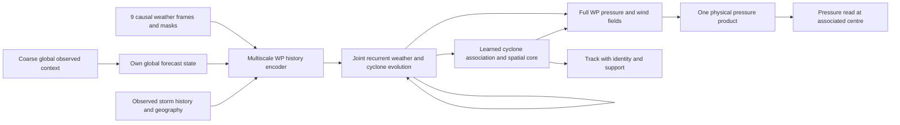

# TrackFormer 1.3.1 — track and pressure research

This is the **fresh 2026-11-02 experiment**, not the archived October experiment
that used the same version number. It investigates a replacement for released
1.2's track/pressure model. No older 1.3 or rainfall model code or weights are
inherited. Existing raw data may retain historical directory names. Released
1.2 remains the exact frozen reference; the active V52 rainfall trainer is separate.

**Status:** runnable Colab regional pilot, with CPU checks and measured data audit.
There is no trained production 1.3.1 model or demonstrated benchmark improvement.
Open `TrackFormer_1_3_1_Train.ipynb`, select a GPU runtime (T4 if available),
and run its cells. CUDA qualification runs on your actual runtime before fitting.

## Colab training

The notebook downloads a hash-checked, self-contained code package and public
ERA5 frames; it never needs access to the Mac's D drive. Only the selected
cohort is fetched. The first two frames measure a download estimate. The estimate
is informational: preparation continues even when it exceeds30minutes, with
live output and resumable verified frames. The31-field data are not bundled in GitHub. Existing prepared data can
be reused by pointing `DATA_DIR` to that folder in Drive. Drive output includes
the normalizer, checkpoint and optimizer/RNG state, progress, and validation.

Default: 64 fixed TRAIN starts, 24 development starts (one per storm), four
epochs, native 241×321 quarter-degree grid, width32 **2,252,513 parameters**,
microbatch1/effective batch4, two-lead truncated backpropagation, activation
checkpointing, FP32 with TF32 disabled, AdamW2e-4. Rollout curriculum is
5/10/15/20 six-hour leads; each epoch is evaluated on all20 leads. Rerunning
the same training cell resumes the last complete optimizer update. A changed
configuration/source/cohort needs a new output folder. No prior1.3 or1.2
weights are loaded.

This first implementation has a ConvGRU history encoder, regional multiscale
convolutions, coarse regional attention and recurrent 31-field increments.
A local pressure association follows motion inferred from its own winds and
history; central pressure is sampled from that exact predicted map. The
objective combines normalized weather MSE, track distance, JMA central pressure
and environmental pressure gradients; dense ERA5 MSLP within150km of a valid
labelled centre is excluded from the conflicting dense-pressure target.
The total is field +0.2track +0.5central_pressure +0.05pressure_gradient,
with track scaled by100km and central pressure by20hPa. TRAIN history alone
fits channel normalization. Future weather/track/pressure are supervision only.

**Not implemented in this bounded pilot:** external global-context branch,
explicit static terrain/land inputs, multi-storm association, a moving fine
core, calibrated ensembles, live operational ingestion, matched1.2 ablations,
full811 comparison and a certified untouched holdout. The broader design below
remains a research proposal. A complete pilot is not a new best-model claim.

## What the data check found

The local weather corpus contains **14,917 actual 0.25° frames**, each with
31 fields on 241×321 nodes across 0–60°N, 100–180°E. It occupies 93.95 GB
already on disk; this work duplicates none of it. Fields include pressure,
surface winds, temperature, SST, and u/v wind, temperature, specific humidity
and geopotential at 850/700/500/300/200 hPa. The existing 5° global context has
the same required times, including continuous longitude across the date line.
It is coarse context, not global quarter-degree weather.

Every one of the fixed **11,978 TRAIN starts / 351 storms (2000–2021)** and
**811 development starts / 24 storms (2022–2023)** has all nine history frames
and all twenty future weather labels in the ledger. All 14,917 files have the
expected size. Forty-four deterministic TRAIN sample frames were rehashed and
decoded; this is **not** a new full 94 GB byte-integrity scan. The reader hashes
every frame it actually consumes. The two splits share neither storms nor
weather timestamps. These 811 starts have been repeatedly used for development.

The rainfall-derived cohort is not automatically the best pressure cohort.
Metadata screening found **920 additional TRAIN starts and 83 development
starts** outside that cohort with complete cached weather, among 11,787 and
844 eligible entries in the separate track archive. These are not simply added
to 11,978/811: the archives have different membership. Label completeness,
duplicate IDs, agency definitions and whole-storm assignment must be reconciled
before an expanded cohort is locked. No extra starts have been silently trained.

The important target problem is measurable. On two distinct storms per TRAIN
year, chosen by case-ID hash before seeing pressure, the ERA5 minimum within
300 km was **10.72 hPa higher on average than JMA central pressure**, median
2.32 hPa, maximum85.49 hPa, across44 cases. For the sampled Meranti2016
issue the values were985.49 versus900.00 hPa. A separate full upstream chunk
download and standard decompression reproduced that stored pressure field
**exactly (maximum difference0 hPa)**. This rules out a range-decoding difference
for this one frame; it does not independently validate ERA5 meteorology.

This is an issue-time TRAIN target diagnostic, **not a model forecast score**.
A nearby minimum can also belong to another low, so the300km diagnostic does
not replace storm association. Blindly training only against those dense fields
could teach the network to weaken intense storms even if the network is larger.

The sample also exposed **576,970 below-ground level/channel cells** marked
finite in the raw archive and2 negative-humidity cells. The new reader adds
physical masks without changing any stored data. Upper-air geopotential is
**m²/s²**, whereas1.2's HGT500 is metres; the conversion is z/9.80665, not a
channel rename. SST over land remains missing rather than zero kelvin.

## Proposed structure



1. **Predict the whole weather state.** Use the31-channel history and static
   terrain/land mask; retain fine local features while coarse tokens exchange
   information across the basin. Forecast six-hour increments recurrently to
   +120h. The global branch also predicts its own future, so later regional
   boundaries never receive future observed weather.
2. **Learn storm motion and pressure together.** Couple cyclone existence and
   association to the same evolving pressure, vorticity and environmental state.
   Keep multiple storms distinct. A global soft minimum can incorrectly sit
   between two lows; association must track identity, not average unrelated lows.
3. **Separate environmental truth from unresolved core truth.** Jointly train
   with dense weather and agency-tagged best-track position/pressure. Test an
   explicit inner-core target-conflict treatment against ordinary dense fitting.
   Point pressure cannot identify the entire inner-core shape; learned detail
   remains a reconstruction, not measured high-resolution structure.
4. **Export a single consistent pressure product.** The learned spatial core
   belongs to that product before readout and rendering. Central pressure is
   sampled from the exact same physical map at the associated centre. Never
   paste a predicted pressure number into a display or shift a field onto a
   preferred route. Pressure support, times and member identity travel together.

The larger width variants in `design.json` remain proposals. The notebook uses
the regional width32 pilot above and measures CUDA memory/time on TRAIN only.
No radius skill or rainfall skill is implied by this work.

## Why these choices

- [WeatherNext Cyclones, Nature2026](https://www.nature.com/articles/s41586-026-10953-2)
  jointly learns atmospheric fields and cyclone-specific targets. Its evidence
  motivates joint supervision here; it does not establish that this much smaller
  proposed regional model will reproduce its results.
- [GraphCast](https://arxiv.org/abs/2212.12794) supports multiscale atmospheric
  communication and autoregressive field forecasting. We use this as an
  architectural direction, not a plan to import a global checkpoint.
- [Shi et al.,2025](https://doi.org/10.1029/2024JH000481) found strong track skill
  but weak intensity/structure and smooth fields in a Pangu operational study.
  Better initial data alone did not resolve intensity there.
- [Aurora, Nature2025](https://www.nature.com/articles/s41586-025-09005-y)
  demonstrates the value of heterogeneous multivariate pretraining and task
  adaptation. Its training scale is far larger than this local archive.
- [FuXi-TC preprint, revised2026](https://arxiv.org/abs/2508.16168) uses richer
  regional simulation targets to improve fine structure. Those targets are not
  present here, so diffusion/downscaling cannot be assumed to recover their skill.
- [ERA5 documentation](https://cds.climate.copernicus.eu/datasets/reanalysis-era5-pressure-levels?tab=overview)
  describes reanalysis rather than an issue-time operational feed. A separate
  real-time analysis adapter must be qualified before live forecasts.
- [NOAA IBTrACS](https://www.ncei.noaa.gov/products/international-best-track-archive)
  combines agency records. Pressure/wind/radius label definitions and source
  agencies must be kept rather than silently mixing incompatible wind averages.

## Experiments and evaluation

Compare the frozen released1.2 with a fresh parameter-matched8-field control,
the same new network with31 fields, and then the joint cyclone/field objective.
This separates the gain from extra data from the gain from a new objective.
Use TRAIN-only normalization/tuning; validate every checkpoint at all20 leads.

Report track km, heading/speed, central-pressure bias/MAE in hPa, pressure-map
RMSE/MAE and gradients, cyclone detection/identity switches, and landfall/strong-
storm tails. Use equal-storm paired scores with storm-cluster uncertainty.
Evaluate whole-map and core support separately. Lower average field error is
insufficient if storms disappear, tracks regress or intense lows become shallow.
Compare native detail separately from common-support scores: interpolation of
1.2's2.5° basin does not create a0.25° reference.

The fixed eleven historical comparisons remain the original issue times. Only
five currently have complete native inputs in this archive; Fung-Wong2025,
TIP1979, Bavi2026, Dolphin2026 and both Choi-Wan2026 starts still need their
input preparation. Those comparisons and full811 evaluation are **not completed**.
No untouched holdout is certified. Do not choose dates based on attractive maps.

## Implemented and checked now

- `contracts.py`: independent causal cached-weather reader, masks, units and
  exact-map pressure sampling; no model or old1.3 imports.
- `audit_data.py`: metadata coverage, source pins, TRAIN-only target diagnostic,
  candidate extra-data inventory and fixed11 input coverage.
- `test_contracts.py`: five CPU fixtures covering future/missing/reversed time
  rejection, underground/humidity masks, physical interpolation, support and
  moving lows on unchanged geography.
- `design.json`: proposed architecture, ablations and validation requirements.
- `model.py`, `data.py`, `train.py`: fresh regional CUDA training and all20-lead
  development exports, with strict source/data/configuration resume identity.
- `prepare_colab.py`, `arco_ranges.py`, `source_contract.py`, `catalog.json.gz`:
  resumable public data retrieval, original value hashes, explicit masks and
  agency-tagged labels. Data derive from ECMWF/Copernicus ERA5 (via public ARCO)
  and NOAA IBTrACS WP v04r01 (JMA pressure). Upstream data terms still apply;
  project source uses the repository MIT license.
- `test_training.py`: CPU same-map readout, all20 rollout, missing-label
  gradients and optimizer/RNG checkpoint replay fixtures. Native-grid CPU
  disposable fitting passed; CUDA/T4 qualification is performed in the notebook.

Run from the project root:

```sh
sh scripts/with_project_storage.sh .venv/bin/python -B 1.3/1.3.1/test_contracts.py
sh scripts/with_project_storage.sh .venv/bin/python -B 1.3/1.3.1/audit_data.py --output output/trackformer-1.3.1-research-NEW
```

The audit requires a new output path and writes only small records. Its main
report is `output/trackformer-1.3.1-research-20261102-v1/data-audit.json`;
the independent source check is `independent-source-spotcheck.json` alongside it.
The original audit performed no fitting. Later Colab preparation added only
disposable CPU test updates and a one-frame public retrieval check; no local
production training, GPU job, website change or scheduled task was launched.
The released1.2 and active V52 rainfall source/checkpoints remain separate.
